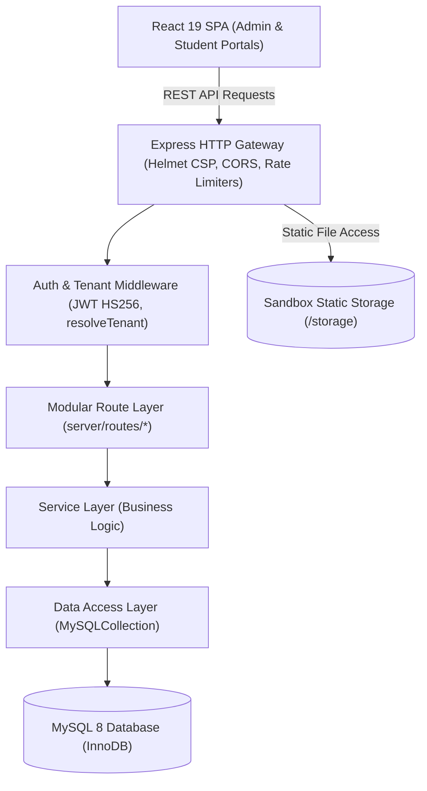
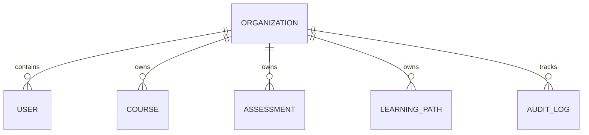
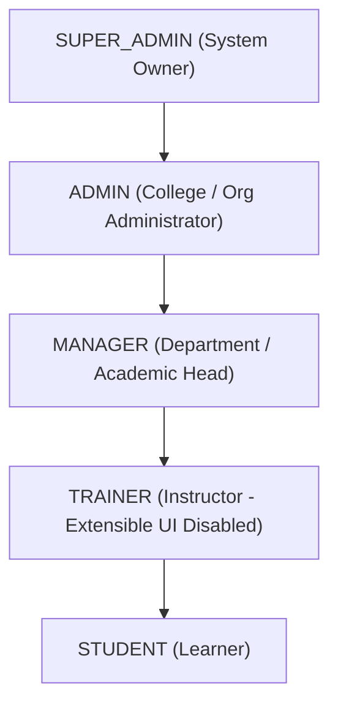

# MRTECHLMS System Architecture

---

## 1. System Overview

MRTECHLMS is a full-stack, enterprise-grade Learning Management System engineered to support multi-tenant higher-education institutions, universities, and corporate training programs. The platform supports structured coursework, modular learning paths, autograded multi-type assessments, interactive coding challenges, and comprehensive analytics.

The system is architected around a decoupled, layered model prioritizing:
- **Defense in Depth**: Cryptographic authentication, role-based authorization, rate limiting, and input validation.
- **Tenant Isolation**: Strict cross-tenant boundaries preventing data leakage between colleges or organizations.
- **Data Integrity**: Soft deletion for auditable entities, preserving historical submissions, grades, and compliance trails.
- **Modular Maintainability**: Clear separation of concern across Routes, Middleware, Services, Repositories, and the Database.

---

## 2. Layered Architecture

### 2.1 Layer Responsibilities

| Layer | Location | Responsibility |
| :--- | :--- | :--- |
| **Presentation** | `src/` | Single-page application built on React 19, Vite, and Tailwind CSS. Provides segregated Admin Console, Student Learning Interface, Assessment Engine, and Code Playground. |
| **Gateway & Security** | `server.ts`, `server/middleware/` | Enforces HTTP security headers (Helmet CSP), restricted CORS origins, rate limiting, and request payload validation (Zod). |
| **Authentication & Tenancy** | `server/middleware/auth.ts`, `server/middleware/tenant.ts` | Cryptographic JWT verification, database-driven role re-validation, suspended user blocking, and tenant scoping. |
| **Routing** | `server/routes/` | HTTP parameter extraction, request routing, and response formatting. |
| **Business Logic** | `server/services/` | Pure business operations, calculation routines, authorization rules, and transactional workflows. |
| **Data Access / Repository** | `server/db.ts` (`MySQLCollection<T>`) | Parameterized SQL execution, JSON field serialization/deserialization, automatic soft delete filtering (`deletedAt IS NULL`), and pagination. |
| **Database** | MySQL | Relational persistence with foreign keys, cascading deletions where appropriate, and composite indexes. |

---

## 3. Multi-Tenancy Architecture

MRTECHLMS implements **Shared-Database, Shared-Schema Tenant Partitioning** with row-level tenant keys (`organizationId`).

### 3.1 Tenant Resolution Pipeline
1. **Header Identification**: Clients send `X-Tenant-ID` or `X-Organization-ID`.
2. **User Context Binding**: When authenticated, `req.user.organizationId` is resolved.
3. **Cross-Tenant Boundary Enforcement**:
   - `SUPER_ADMIN`: Granted global multi-tenant access; can view, manage, or switch across any organization.
   - `ADMIN` / `MANAGER` / `STUDENT`: Confined strictly to their assigned `organizationId`. If a non-super-admin supplies a mismatched `X-Tenant-ID` header, the request is rejected with **403 Forbidden**.
4. **Default Backward Compatibility Bridge**: All legacy single-tenant records are mapped to `org-default` ("Default Institution", slug: `default`), ensuring zero interruption for existing users.

---

## 4. User Role Hierarchy

| Role | Key Permissions |
| :--- | :--- |
| `SUPER_ADMIN` | Global platform administration, creating/suspending organizations, tenant configuration, cross-tenant auditing. |
| `ADMIN` | Organization administration, managing user accounts, creating/publishing courses and assessments, assigning assessments, reviewing submissions. |
| `MANAGER` | Department oversight, viewing student progress and assessment reports, batch assignment. |
| `TRAINER` | Course authoring and evaluation. *(Data model fully implemented; UI toggled off per design specification)*. |
| `STUDENT` | Course browsing, taking enrolled lessons, attempting assigned assessments, coding playground, personal dashboard. |

---

## 5. Soft Delete Architecture

To satisfy regulatory and academic compliance, critical records are never destructively erased by default. Destructive deletion would invalidate historical certifications, student transcripts, and audit trails.

### 5.1 Soft-Deletable Entities
- `organizations` (`deletedAt`)
- `users` (`deletedAt`)
- `courses` (`deletedAt`)
- `assessments` (`deletedAt`)
- `questions` (`deletedAt`)
- `learning_paths` (`deletedAt`)

### 5.2 Implementation
`MySQLCollection<T>` transparently injects `WHERE \`deletedAt\` IS NULL` on all `find()`, `findOne()`, and `count()` queries unless `{ includeDeleted: true }` is explicitly provided. Calling `softDelete(id)` updates `deletedAt` with the current ISO timestamp, and `restore(id)` clears it back to `NULL`.

---

## 6. Audit Logging & Security Observability

Every security-relevant operation is persisted asynchronously to the `audit_logs` table via `logAuditEvent()`.

### Key Tracked Operations:
- `user_login` / `login_failed` / `user_logout`
- `create_user` / `change_password` / `status_change`
- `create_organization` / `update_organization` / `delete_organization`
- `upload_file` (with MIME, file size, target folder)
- `publish_assessment` / `archive_assessment`

The audit logger is completely non-blocking: logging execution is wrapped in a fail-safe catch handler so that logging persistence anomalies never interrupt primary user transactions.
