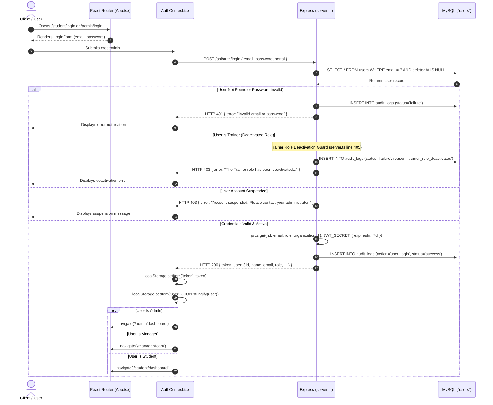
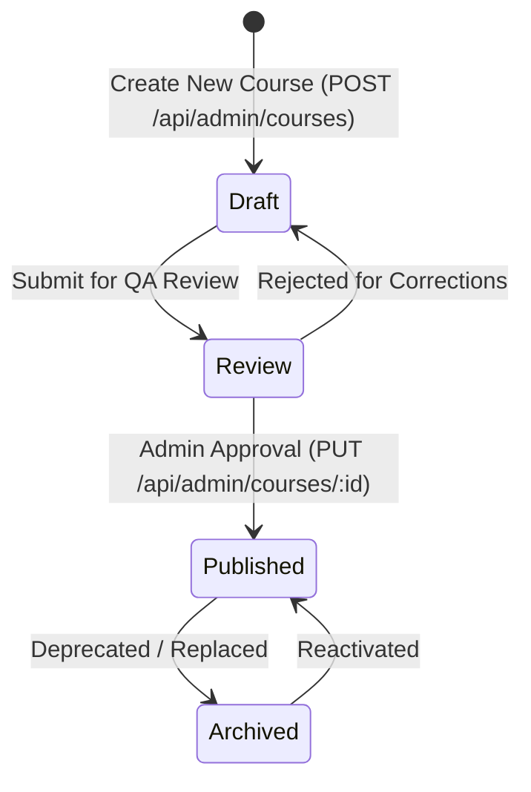
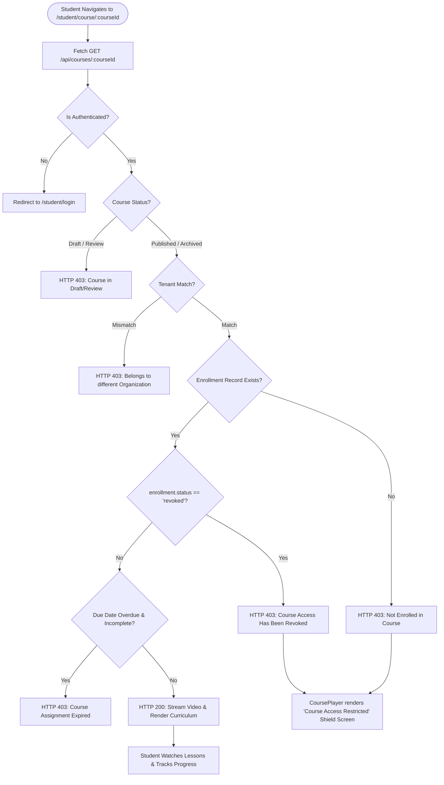
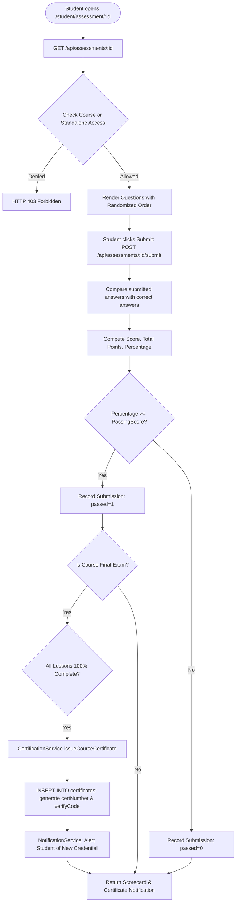
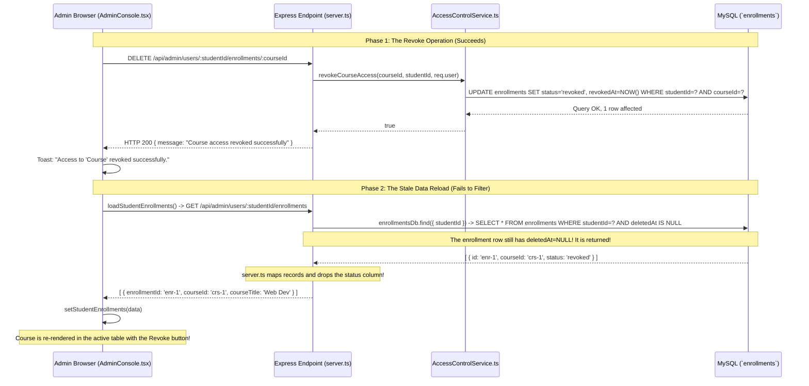

# MRTECHLMS — Complete Existing System Documentation & Architectural Audit

**Project Path:** `D:\malla\office\MRTECHLMS`  
**System Version:** 2.0 (Post-Cleanup Clean Baseline)  
**Author:** AI Technical Audit Agent  
**Date:** October 7, 2026  
**Confidentiality:** Internal Architecture Reference  

---

## Table of Contents

1. [Application Overview](#1-application-overview)
2. [Complete Folder and File Structure](#2-complete-folder-and-file-structure)
3. [All Application Pages, Modals and Navigation Inventory](#3-all-application-pages-modals-and-navigation-inventory)
4. [Role-Based Access and Authentication Flow](#4-role-based-access-and-authentication-flow)
5. [Complete Admin Portal Workflows](#5-complete-admin-portal-workflows)
6. [Complete Student Portal Workflows](#6-complete-student-portal-workflows)
7. [Course Management & Authoring Studio Workflow](#7-course-management--authoring-studio-workflow)
8. [Database Schema & Architecture Summary](#8-database-schema--architecture-summary)
9. [API Architecture & Endpoint Overview](#9-api-architecture--endpoint-overview)
10. [End-to-End Workflow & Navigation Diagrams](#10-end-to-end-workflow--navigation-diagrams)
11. [Identified Technical Issues & Current Limitations](#11-identified-technical-issues--current-limitations)
12. [Course Access Revocation — Existing Implementation and Failure Analysis](#12-course-access-revocation--existing-implementation-and-failure-analysis)

---

## 1. Application Overview

### 1.1 What MRTECHLMS Currently Does
MRTECHLMS (Medha Rubiks Learning Management System) is an enterprise technical education and career launchpad platform. It merges:
* **Structured Courseware:** Video lectures, PDF materials, interactive coding exercises, and module-based lesson progression.
* **Curated Learning Paths:** Multi-course tracks designed for professional career transformation (e.g. *Full Stack Web Architect*, *Cloud Native Architect*).
* **Automated Assessment & Examination Engine:** Single-choice, multiple-choice, and true/false assessments with instant scoring, passing thresholds, randomized question ordering, and detailed scorecards.
* **Interactive Code Execution Sandbox:** A 38-challenge coding practice environment supporting Java, Python, and JavaScript executed in isolated environments with hidden test cases.
* **Cryptographic Certification:** PDFKit-generated vector certificates with unique certificate numbers and verification tokens, verified publicly without revealing private learner PII.
* **Gamification & Engagement:** XP points, badges, dynamic streaks, and public/departmental leaderboards.
* **Enterprise Multi-Tenancy & Governance:** Departmental hierarchy, cohorts, user groups, bulk Excel provisioning, granular course access control, and audit logging.

### 1.2 Actual Technology Stack
* **Frontend:**
  * React 19 (`react: ^19.0.1`, `react-dom: ^19.0.1`)
  * React Router v7 (`react-router-dom: ^7.18.3`)
  * Tailwind CSS v4 (`tailwindcss: ^4.1.14`, `@tailwindcss/vite: ^4.1.14`)
  * Monaco Editor (`@monaco-editor/react: ^4.7.0`)
  * UI Icons: `lucide-react: ^0.546.0`
  * Motion Animations: `motion: ^12.23.24`
* **Backend:**
  * Node.js runtime with `tsx` execution engine (`tsx: ^4.21.0`)
  * Express 4 (`express: ^4.21.2`)
  * Security: `helmet: ^8.3.0`, `cors: ^2.8.6`, `bcryptjs: ^3.0.3`, `jsonwebtoken: ^9.0.3`
  * PDF Generation: `pdfkit: ^0.20.2`
  * Data Processing: `xlsx: ^0.18.5`, `multer: ^2.3.0`, `zod: ^4.6.5`
  * AI Layer: Google Gemini SDK (`@google/genai: ^2.4.0`)
  * Development Bundler: Vite 6 in middleware mode (`vite: ^6.2.3`)
* **Database & Persistence:**
  * MySQL 8.0 on `127.0.0.1:3306` (Schema: `mrtechlms`)
  * Driver: `mysql2/promise: ^3.11.0`
  * Abstraction: Application-owned `MySQLCollection<T>` (`server/db.ts`)

### 1.3 Communication Architecture
* **React to Express:** The frontend makes standard asynchronous `fetch()` HTTP requests to `/api/*`. During development (`NODE_ENV !== "production"`), `server.ts` mounts Vite dev server in middleware mode directly on `app.use(vite.middlewares)`. This allows both Express REST API routes and the React Single Page Application (SPA) to serve from the same origin: `http://localhost:3000`.
* **Express to MySQL:** Express uses a unified `mysql2/promise` connection pool (`server/mysql.ts`). The `MySQLCollection<T>` class encapsulates SQL queries with prepared statement placeholders (`?`), automatic JSON field serialization/deserialization, boolean conversion, and soft-delete filtering.
* **Authentication & Course Access:**
  * Authenticated requests carry `Authorization: Bearer <JWT_TOKEN>`.
  * Middleware `authenticateToken` validates the token and attaches `req.user`.
  * Course access is managed via explicit allocation records in the `enrollments` table. Students **cannot** self-enroll into courses; access is provisioned by LMS Administrators.

### 1.4 Feature Status Matrix

| Functional Pillar | Implementation State | Evidence / Notes |
|---|---|---|
| **Public Branded Landing Page** | **Complete** | Responsive hero, code switcher, trust metrics, contact form, theme toggle. |
| **Authentication & Gateways** | **Complete** | Dedicated `/student/login`, `/admin/login`, `/gateway`. Trainer role deactivated. |
| **Course Catalog & Player** | **Complete** | Syllabus, video streaming, PDF viewer, lesson completion tracking. |
| **Course Access Allocation** | **Complete** | Individual, bulk Excel, and group assignments work. |
| **Course Access Revocation** | **Partially Implemented (UI Bug)** | Backend updates `status='revoked'`; admin & student listing queries fail to filter it out. |
| **Assessment Engine** | **Complete** | Standalone & course-final exams, automated grading, submission scorecards. |
| **Certificate Engine** | **Complete** | PDFKit vector certificates, verification tokens, public masking page. |
| **Coding Sandbox** | **Complete** | 38 challenges, Monaco editor, public/private test evaluation, playground. |
| **Gamification** | **Complete** | Points ledger, streak tracker, badge unlocks, leaderboards. |
| **Analytics & Reports** | **Complete** | Dashboard KPI cards, 14-day velocity graphs, Excel export. |
| **Multi-Tenancy** | **Complete** | Tenant isolation, departments, cohorts, groups. |
| **AI Mentorship** | **Complete** | Conversational tutor grounded in curriculum via Google Gemini SDK. |
| **Enterprise Integrations** | **Complete** | API keys, Webhooks, LTI 1.3, SCORM, xAPI stubs. |

---

## 2. Complete Folder and File Structure

```text
MRTECHLMS/
├── package.json                       # Scripts and project dependencies
├── server.ts                          # Express server entry point, middleware, all REST route bindings
├── vite.config.ts                     # Vite 6 configuration with Tailwind CSS plugin
├── tsconfig.json                      # TypeScript configuration
├── .env                               # Local database and JWT configuration (redacted)
│
├── src/                               # React 19 Frontend Application
│   ├── main.tsx                       # React DOM root entry point
│   ├── App.tsx                        # Client-side router, layout wrappers, and route guards
│   ├── types.ts                       # Shared TypeScript interfaces (User, Course, Enrollment, etc.)
│   ├── index.css                      # Tailwind CSS v4 styling rules
│   │
│   ├── assets/                        # Static branding logos and icons
│   │   ├── mr-logo-full.jpg
│   │   └── mr-logo-icon.png
│   │
│   ├── context/                       # Global React Context providers
│   │   ├── AuthContext.tsx            # Session state, JWT storage, login, logout, user profile
│   │   ├── NotificationContext.tsx    # Toast notifications, modal confirmation alerts
│   │   └── ThemeContext.tsx           # Dark/light theme state and persistent preferences
│   │
│   ├── layouts/                       # Portal shell layouts (sidebar, header, mobile drawers)
│   │   ├── AdminLayout.tsx            # Administrative portal container with Admin Sidebar
│   │   ├── StudentLayout.tsx          # Student portal container with Student Sidebar
│   │   └── ManagerLayout.tsx          # Manager team portal container
│   │
│   ├── components/                    # Reusable UI consoles and widgets
│   │   ├── AdminConsole.tsx           # Legacy/Consolidated admin workspace (Users, Access, Courses)
│   │   ├── AssessmentConsole.tsx      # Legacy assessment workspace
│   │   ├── AssessmentViewer.tsx       # Interactive student exam-taking runner
│   │   ├── BlogPortal.tsx             # Blog community feed, markdown reader, comments
│   │   ├── CodingPractice.tsx         # Coding practice challenge selector & runner
│   │   ├── CoursePlayer.tsx           # Comprehensive video/lesson viewer & AI explainer
│   │   ├── LearningPathPlayer.tsx     # Student learning path stage runner
│   │   ├── NotificationBell.tsx       # Header notification bell with unread badge & dropdown
│   │   ├── NotificationPreferencesModal.tsx # Delivery channel preference modal
│   │   ├── ProfileConsole.tsx         # Avatar upload, password update, learning preferences
│   │   ├── Sidebar.tsx                # Unified sidebar handling Student, Admin, Manager menus
│   │   ├── StudentDashboard.tsx       # Student dashboard stats, enrolled tracks, continue learning
│   │   ├── ThemeQuickControls.tsx     # Compact light/dark toggle and quick profile links
│   │   ├── TrainerConsole.tsx         # Legacy trainer console component
│   │   │
│   │   ├── admin/                     # Specialized Admin Studio Components
│   │   │   ├── CourseAuthoringStudio.tsx          # 5-tab complete course authoring suite
│   │   │   ├── AssessmentBuilder.tsx              # Assessment builder & question editor
│   │   │   ├── AssessmentAssignmentsModal.tsx     # Standalone exam allocation modal
│   │   │   ├── AssessmentResultsModal.tsx         # Student attempts summary modal
│   │   │   ├── AssessmentSubmissionDetailModal.tsx# Detailed scorecard answer inspector
│   │   │   └── LearningPathBuilder.tsx            # Multi-course learning path designer
│   │   │
│   │   ├── coding/                    # Specialized Coding Sandbox Components
│   │   │   ├── CodePlayground.tsx     # Multi-language live interactive code sandbox
│   │   │   ├── CodingCatalog.tsx      # 38-challenge catalog with difficulty filters
│   │   │   ├── CodingWorkspace.tsx    # Monaco split-pane problem description & terminal
│   │   │   ├── MonacoCodeEditor.tsx   # Monaco editor React wrapper with themes
│   │   │   ├── PlaygroundProgramsModal.tsx # Student saved programs manager
│   │   │   └── WebPlayground.tsx      # HTML/CSS/JS live web preview sandbox
│   │   │
│   │   ├── home/                      # Public Branded Landing Page Sections
│   │   │   ├── HomeNavbar.tsx         # Public navigation bar with login CTAs
│   │   │   ├── HomeHero.tsx           # Hero section with interactive code playground card
│   │   │   ├── HomePrograms.tsx       # Training curriculum overview
│   │   │   ├── HomeServices.tsx       # Enterprise training & placement offerings
│   │   │   ├── HomeJourney.tsx        # 4-step learning roadmap
│   │   │   ├── HomeWhyUs.tsx          # Key advantages and trust metrics
│   │   │   ├── HomeAbout.tsx          # Company background and mission
│   │   │   ├── HomeCareers.tsx        # Placement partners and hiring channels
│   │   │   ├── HomeContact.tsx        # Interactive student enquiry form
│   │   │   └── HomeFooter.tsx         # Branded footer and legal links
│   │   │
│   │   ├── routes/
│   │   │   └── ProtectedRoutes.tsx    # StudentProtectedRoute, AdminProtectedRoute, ManagerProtectedRoute
│   │   │
│   │   └── student/
│   │       └── CourseOverviewModal.tsx# Modal displaying full course syllabus
│   │
│   └── pages/                         # Route Page Components
│       ├── CompanyHomePage.tsx        # Public landing page (`/`)
│       ├── PortalGateway.tsx          # Gateway selector (`/gateway`)
│       ├── StudentLogin.tsx           # Student login screen (`/student/login`)
│       ├── AdminLogin.tsx             # Admin login screen (`/admin/login`)
│       ├── AdminRegister.tsx          # Initial administrator bootstrap (`/admin/register`)
│       ├── PublicCertificateVerificationPage.tsx # Public certificate verify (`/verify-certificate`)
│       │
│       ├── admin/                     # Admin Portal Route Pages (`/admin/*`)
│       │   ├── AdminDashboardPage.tsx
│       │   ├── AdminUsersPage.tsx
│       │   ├── AdminCoursesPage.tsx
│       │   ├── AdminAssessmentsPage.tsx
│       │   ├── AdminAssessmentBuilderPage.tsx
│       │   ├── AdminAssessmentResultsPage.tsx
│       │   ├── AdminLearningPathsPage.tsx
│       │   ├── AdminLearningPathBuilderPage.tsx
│       │   ├── AdminCertificatesPage.tsx
│       │   ├── AdminOrganizationPage.tsx
│       │   ├── AdminNotificationsPage.tsx
│       │   ├── AdminAnalyticsPage.tsx
│       │   ├── AdminGamificationPage.tsx
│       │   ├── AdminIntegrationsPage.tsx
│       │   ├── AdminBlogPage.tsx
│       │   └── AdminProfilePage.tsx
│       │
│       ├── student/                   # Student Portal Route Pages (`/student/*`)
│       │   ├── StudentDashboardPage.tsx
│       │   ├── CourseCatalogPage.tsx
│       │   ├── CoursePlayerPage.tsx
│       │   ├── LearningPathsPage.tsx
│       │   ├── LearningPathPlayerPage.tsx
│       │   ├── StudentCertificatesPage.tsx
│       │   ├── AssessmentsPage.tsx
│       │   ├── AssessmentViewerPage.tsx
│       │   ├── CodingPracticePage.tsx
│       │   ├── StudentGamificationPage.tsx
│       │   ├── BlogPage.tsx
│       │   └── ProfilePage.tsx
│       │
│       └── manager/                   # Manager Portal Route Pages (`/manager/*`)
│           └── ManagerTeamPage.tsx
│
└── server/                            # Backend Engine & Micro-Services
    ├── mysql.ts                       # MySQL connection pool
    ├── db.ts                          # MySQLCollection abstraction & table definitions
    ├── audit.ts                       # Structured security audit logging service
    ├── errorHandler.ts                # Centralized error responses
    ├── rateLimiter.ts                 # IP-based rate limiting
    ├── validation.ts                  # Zod validation schemas
    ├── seed.ts                        # Idempotent database schema & initial seed runner
    ├── codeExecution.ts               # Local runtime detection & subprocess code execution
    ├── codingSeedData.ts              # 38 curriculum coding challenges
    ├── codingReferenceSolutions.ts    # Official reference implementations
    │
    ├── middleware/
    │   ├── auth.ts                    # JWT verification & role authorization middleware
    │   └── tenant.ts                  # Multi-tenant isolation header middleware
    │
    ├── services/                      # Business Logic Service Layer
    │   ├── access-control.service.ts  # Enrollment granting, revocation, access matrices
    │   ├── course.service.ts          # Course syllabus, module/lesson authoring, student access check
    │   ├── student-learning.service.ts# Student dashboard feeds, resume state, syllabus
    │   ├── certification.service.ts   # Eligibility checks, PDF generation, verification
    │   ├── analytics.service.ts       # KPI metrics, 14-day velocity, Excel reports
    │   ├── gamification.service.ts    # Points, streaks, badge unlock triggers
    │   ├── organization.service.ts    # Departments, cohorts, groups, bulk imports
    │   ├── notification.service.ts    # In-app alerts, email queue dispatching
    │   ├── scheduler.service.ts       # Background sweep for reminders & email queue
    │   ├── tenant.service.ts          # Organization tenant resolver
    │   │
    │   ├── ai/                        # Google Gemini AI Integrations
    │   │   ├── ai-mentor.service.ts   # Conversational curriculum tutor
    │   │   ├── ai-lesson-tutor.service.ts # Lesson concept explainer
    │   │   ├── ai-coding-hints.service.ts # Progressive coding hints
    │   │   ├── ai-course-generator.service.ts # Generative course syllabus
    │   │   └── ai-quiz-generator.service.ts   # Generative MCQ quizzes
    │   │
    │   ├── coding/                    # Secure Code Execution Engine
    │   │   ├── coding-execution.service.ts # Execution orchestrator
    │   │   ├── process-isolated.driver.ts  # Subprocess isolation driver
    │   │   ├── security-validator.ts       # AST / regex malicious code blocking
    │   │   └── execution-queue.service.ts  # Job queue
    │   │
    │   └── integrations/              # Enterprise Integrations
    │       ├── public-api.service.ts  # Scoped API key authentication
    │       ├── webhook.service.ts     # Outgoing webhook dispatching
    │       ├── scorm.service.ts       # SCORM package parser
    │       ├── lti.service.ts         # LTI 1.3 tool registration
    │       └── xapi.service.ts        # xAPI statement dispatcher
    │
    └── routes/                        # Modular Express Route Handlers
        ├── analytics.routes.ts
        ├── certificates.routes.ts
        ├── gamification.routes.ts
        ├── organization.routes.ts
        ├── notification.routes.ts
        ├── integrations.routes.ts
        ├── tenants.routes.ts
        ├── ai.routes.ts
        └── v1.routes.ts
```

---

## 3. All Application Pages, Modals and Navigation Inventory

| # | Display Name | Route / URL | Type | Component | Roles | How Reached | Primary Actions | API Calls |
|---|---|---|---|---|---|---|---|---|
| 1 | **Home** | `/` | Page | `CompanyHomePage` | Public | Root URL | View programs, switch code tabs, submit enquiry, link to login | `GET /api/courses` |
| 2 | **Portal Gateway** | `/gateway` | Page | `PortalGateway` | Public | Navbar "Access Learning Portal" | Choose between Student and Admin portals | None |
| 3 | **Student Login** | `/student/login` | Page | `StudentLogin` | Public | Navbar "Student Login" | Enter email & password | `POST /api/auth/login` |
| 4 | **Admin Login** | `/admin/login` | Page | `AdminLogin` | Public | Gateway "Admin Login" | Enter admin credentials | `POST /api/auth/login` |
| 5 | **Admin Bootstrap**| `/admin/register` | Page | `AdminRegister` | Public | Direct URL | Initial administrator setup with secret key | `POST /api/auth/register-admin` |
| 6 | **Verify Credential**| `/verify-certificate/:code?` | Page | `PublicCertificateVerificationPage` | Public | Navbar "Verify Credential" | Validate certificate number/code, download PDF | `GET /api/verify-certificate/:code` |
| 7 | **My Learning** | `/student/dashboard` | Page | `StudentDashboardPage` | Student | Login redirect, Sidebar | View active courses, resume learning, review quick stats | `GET /api/student/dashboard` |
| 8 | **Browse Courses** | `/student/courses` | Page | `CourseCatalogPage` | Student | Sidebar | Search courses, view syllabus modal, launch course player | `GET /api/courses`, `GET /api/student/dashboard` |
| 9 | **Course Player** | `/student/course/:courseId` | Page | `CoursePlayerPage` | Student | Catalog "Study", Dashboard "Resume" | Watch video, complete lessons, ask AI tutor, take final exam | `GET /api/courses/:id`, `POST /api/lessons/:id/complete` |
| 10| **Course Syllabus** | *Modal* | Modal | `CourseOverviewModal` | Student | Catalog "View Syllabus" | Inspect course modules and lesson breakdown | `GET /api/student/courses/:id/overview` |
| 11| **Learning Paths**| `/student/learning-paths` | Page | `StudentLearningPathsPage` | Student | Sidebar | Browse curated multi-course tracks | `GET /api/student/learning-paths` |
| 12| **Path Player** | `/student/learning-path/:pathId` | Page | `StudentLearningPathPlayerPage` | Student | Path card "Enter Track" | Study sequential learning path items | `GET /api/student/learning-paths/:id` |
| 13| **My Certificates**| `/student/certificates` | Page | `StudentCertificatesPage` | Student | Sidebar | View earned certificates, download PDFKit document | `GET /api/certificates/my-certificates`, `GET /api/certificates/:id/pdf` |
| 14| **My Assessments** | `/student/assessments` | Page | `AssessmentsPage` | Student | Sidebar | View assigned exams, launch examination runner | `GET /api/student/assessments` |
| 15| **Exam Runner** | `/student/assessment/:assessmentId` | Page | `AssessmentViewerPage` | Student | Exam list "Start Assessment" | Answer timed questions, submit for automatic scoring | `GET /api/assessments/:id`, `POST /api/assessments/:id/submit` |
| 16| **Coding Practice** | `/student/coding-practice` | Page | `CodingPracticePage` | Student | Sidebar | Filter 38 problems, Monaco editor, run test cases | `GET /api/coding/challenges`, `POST /api/coding/run`, `POST /api/coding/submit` |
| 17| **Achievements** | `/student/gamification` | Page | `StudentGamificationPage` | Student | Sidebar | Inspect points, current badge tier, global leaderboard | `GET /api/gamification/profile`, `GET /api/gamification/leaderboard` |
| 18| **Blog Community** | `/student/blogs` | Page | `StudentBlogPage` | Student | Sidebar | Read tech articles, write comments, bookmark posts | `GET /api/blogs`, `POST /api/blogs/:id/comments` |
| 19| **Student Profile**| `/student/profile` | Page | `StudentProfilePage` | Student | Header avatar, Sidebar | Update name, change password, upload profile photo | `GET /api/auth/me`, `PUT /api/auth/profile` |
| 20| **Admin Overview** | `/admin/dashboard` | Page | `AdminDashboardPage` | Admin | Login redirect, Sidebar | View high-level metrics, recent completions, quick links | `GET /api/admin/dashboard` |
| 21| **Manage Users** | `/admin/users` (tab `users`) | Page | `AdminUsersPage` | Admin | Sidebar | Provision user, bulk Excel upload, suspend user, open access modal | `GET /api/admin/users`, `POST /api/admin/users`, `POST /api/admin/users/bulk-import` |
| 22| **Course Access** | `/admin/users` (tab `access`) | Tab | `AdminConsole` (subtab `access`) | Admin | Manage Users tab bar | Select student, grant course, revoke course access | `GET /api/admin/users/:id/enrollments`, `POST /api/admin/users/:id/enrollments`, `DELETE /api/admin/users/:id/enrollments/:courseId` |
| 23| **User Access Modal**| *Modal* | Modal | `AdminConsole` (modal) | Admin | User row "Manage Access" | Granular modal granting/revoking courses and standalone exams | `GET /api/admin/users/:id/access`, `POST /api/admin/users/:id/enrollments`, `DELETE /api/admin/users/:id/enrollments/:courseId` |
| 24| **Manage Courses**| `/admin/courses` | Page | `AdminCoursesPage` | Admin | Sidebar | Filter courses, toggle published/draft status, launch Studio | `GET /api/admin/courses`, `PUT /api/admin/courses/:id` |
| 25| **Authoring Studio**| *Conditional* | Studio | `CourseAuthoringStudio` | Admin | Courses "New Course" / "Edit" | 5-tab editor: Metadata, Curriculum, Exams, Publish, Access | `GET /api/admin/courses/:id`, `POST /api/admin/courses/:id/modules`, `GET /api/admin/courses/:id/access` |
| 26| **Assessments** | `/admin/assessments` | Page | `AdminAssessmentsPage` | Admin | Sidebar | Filter standalone & course exams, launch builder | `GET /api/admin/assessments`, `DELETE /api/admin/assessments/:id` |
| 27| **Exam Builder** | `/admin/assessment-builder/:id?` | Page | `AdminAssessmentBuilderPage` | Admin | Assessments "Create Exam" / "Edit" | Author questions, set pass marks, configure explanations | `GET /api/admin/assessments/:id`, `POST /api/admin/assessments/:id/questions` |
| 28| **Exam Results** | `/admin/assessment-results` | Page | `AdminAssessmentResultsPage` | Admin | Sidebar | Inspect student submissions, passing percentages, detailed answers | `GET /api/admin/assessments/:id/submissions`, `GET /api/admin/assessments/submissions/:submissionId` |
| 29| **Learning Paths**| `/admin/learning-paths` | Page | `AdminLearningPathsPage` | Admin | Sidebar | Manage curated tracks and assign student cohorts | `GET /api/admin/learning-paths` |
| 30| **Certificates** | `/admin/certificates` | Page | `AdminCertificatesPage` | Admin | Sidebar | Search issued credentials, manually issue, revoke, reissue | `GET /api/admin/certificates`, `POST /api/admin/certificates/issue`, `POST /api/admin/certificates/:id/revoke` |
| 31| **Organization** | `/admin/organization` | Page | `AdminOrganizationPage` | Admin | Sidebar | Configure branding, departments, cohorts, and user groups | `GET /api/admin/departments`, `POST /api/admin/groups` |
| 32| **Analytics** | `/admin/analytics` | Page | `AdminAnalyticsPage` | Admin | Sidebar | View 14-day velocity, completion funnels, export Excel | `GET /api/admin/analytics/overview`, `GET /api/admin/analytics/export/courses` |
| 33| **Gamification** | `/admin/gamification` | Page | `AdminGamificationPage` | Admin | Sidebar | Configure point multipliers, manage badge definitions | `GET /api/admin/gamification/config`, `POST /api/admin/gamification/award-points` |
| 34| **Integrations** | `/admin/integrations` | Page | `AdminIntegrationsPage` | Admin | Sidebar | Provision API keys, test webhooks, configure SSO, SCORM | `GET /api/integrations/api-keys`, `POST /api/integrations/webhooks/test` |
| 35| **Notifications** | `/admin/notifications` | Page | `AdminNotificationsPage` | Admin | Sidebar | Broadcast system alerts, view email queue and delivery logs | `GET /api/notifications`, `POST /api/admin/notifications/broadcast` |
| 36| **Moderate Blogs**| `/admin/blogs` | Page | `AdminBlogPage` | Admin | Sidebar | Review and publish student articles, moderate comments | `GET /api/blogs`, `PUT /api/blogs/:id` |
| 37| **Admin Profile** | `/admin/profile` | Page | `AdminProfilePage` | Admin | Header avatar, Sidebar | Update admin credentials, system security preferences | `GET /api/auth/me`, `PUT /api/auth/profile` |
| 38| **Team Dashboard**| `/manager/team` | Page | `ManagerTeamPage` | Manager | Manager login redirect | Review departmental team members and course progress | `GET /api/manager/team` |

---

## 4. Role-Based Access and Authentication Flow



### 4.1 Token Storage & Session Recovery
* On initial application load, `AuthContext.tsx` reads `token` and `user` from `localStorage`.
* It immediately dispatches `GET /api/auth/me` with `Authorization: Bearer ${token}` to validate token freshness and retrieve the live user profile from MySQL.
* If `GET /api/auth/me` returns 401/403 (token expired or invalidated), `AuthContext.tsx` invokes `logout()`: clears `localStorage`, sets `currentUser = null`, and redirects the user to `/gateway`.

### 4.2 Protected Route Guards (`src/components/routes/ProtectedRoutes.tsx`)
* **`AdminProtectedRoute`:** Checks `currentUser.role === UserRole.ADMIN`. If not, redirects to `/admin/login`.
* **`StudentProtectedRoute`:** Checks `currentUser.role === UserRole.STUDENT`. If not, redirects to `/student/login`.
* **`ManagerProtectedRoute`:** Checks `currentUser.role === UserRole.MANAGER || currentUser.role === UserRole.ADMIN`. If not, redirects to `/gateway`.

### 4.3 Trainer Role Legacy Handling
* In `server.ts` (lines 404–409), login requests for users with `role === UserRole.TRAINER` or `trainer@lms.com` are intercepted and rejected with HTTP 403.
* Legacy `/api/trainer/*` endpoints in `server.ts` check `if (req.user!.role !== UserRole.TRAINER && req.user!.role !== UserRole.ADMIN) return res.status(403)`. Administrators are permitted to execute these legacy endpoints if needed.

---

## 5. Complete Admin Portal Workflows

### 5.1 Admin Overview (`/admin/dashboard`)
* **Component:** `AdminDashboardPage.tsx`
* **Workflow:** Upon entry, requests `GET /api/admin/dashboard`. Displays 4 key metric cards: Total Learners, Total Courses, Total Enrollments, and Submissions. Features quick actions to provision users, create courses, build exams, or inspect system logs.

### 5.2 Manage Users (`/admin/users`, subtab `users`)
* **Component:** `AdminUsersPage.tsx` rendering `AdminConsole.tsx`
* **Features:**
  1. **Single User Provisioning:** Modal form accepting name, email, role, password, and optional department/manager. Calls `POST /api/admin/users`.
  2. **Bulk Excel Provisioning:** Uploads `.xlsx` spreadsheet matching template headers (`name`, `email`, `role`, `password`, `department`). Calls `POST /api/admin/users/bulk-import`.
  3. **Account Suspension:** Toggles active vs suspended state via `PUT /api/admin/users/:id/status`.
  4. **Account Deletion:** Soft-deletes user (`DELETE /api/admin/users/:id`).
  5. **Granular Access Modal:** Clicking "Manage Access" opens the User Access Modal.

### 5.3 Course Access Control (`/admin/users`, subtab `access`)
* **Component:** `AdminConsole.tsx` (lines 904–1005)
* **Workflow:**
  1. Admin selects a student from the dropdown.
  2. The client calls `GET /api/admin/users/:studentId/enrollments`.
  3. Active course enrollments are rendered in a table.
  4. **Grant Access:** The Admin selects an unassigned course and clicks "Grant Access", calling `POST /api/admin/users/:studentId/enrollments`.
  5. **Revoke Access:** The Admin clicks "Revoke", confirming in the danger modal. The client calls `DELETE /api/admin/users/:studentId/enrollments/:courseId`. *(Refer to Section 12 for the detailed failure analysis of this subtab).*

### 5.4 Course Management & Authoring (`/admin/courses`)
* **Component:** `AdminCoursesPage.tsx` rendering `AdminConsole.tsx` (subtab `courses`) and `CourseAuthoringStudio.tsx`
* **Workflow:** Lists all academy courses. Clicking "New Course" or "Edit" mounts the full-screen 5-tab `CourseAuthoringStudio`:
  * Tab 1: **Info** (Title, Category, Difficulty, Description, Thumbnail, Banner, Status).
  * Tab 2: **Curriculum** (Add/Edit Modules, Reorder Modules, Add/Edit Lessons with Video/PDF/Text/Code content, Reorder Lessons).
  * Tab 3: **Assessments** (Configure Lesson Quizzes or Course Final Certification Exam).
  * Tab 4: **Publish** (Pre-publish validation checklist, State transitions: Draft → Review → Published → Archived).
  * Tab 5: **Access** (Bulk assignment by student, group assignment, due date extensions, and revocation management).

### 5.5 Assessment Management (`/admin/assessments`)
* **Component:** `AdminAssessmentsPage.tsx` and `AdminAssessmentBuilderPage.tsx`
* **Workflow:** Displays all exams. Admins can create standalone assessments or attach exams to courses. `AssessmentBuilder.tsx` allows authoring questions, defining multiple choice options, setting points and negative marking, configuring explanations, and assigning exams to students.

### 5.6 Assessment Results & Grading (`/admin/assessment-results`)
* **Component:** `AdminAssessmentResultsPage.tsx`
* **Workflow:** Requests `GET /api/admin/assessments/:id/submissions`. Lists student attempts, scores, and pass/fail status. Clicking an attempt opens `AssessmentSubmissionDetailModal.tsx` showing question-by-question responses, correct answers, and point allocations.

### 5.7 Certification Register (`/admin/certificates`)
* **Component:** `AdminCertificatesPage.tsx`
* **Workflow:** Requests `GET /api/admin/certificates`. Displays all issued student credentials. Admins can manually issue a certificate (`POST /api/admin/certificates/issue`), revoke a certificate with a documented reason (`POST /api/admin/certificates/:id/revoke`), or restore a revoked credential (`POST /api/admin/certificates/:id/reissue`).

### 5.8 Organization Management (`/admin/organization`)
* **Component:** `AdminOrganizationPage.tsx`
* **Workflow:** Manages enterprise multi-tenancy:
  * Departments: Create business units and assign departmental managers (`/api/admin/departments`).
  * Cohorts: Define training batches with start/graduation dates (`/api/admin/cohorts`).
  * Groups: Create assignment groups and map students for bulk enrollment (`/api/admin/groups`).
  * Tenant Branding: Update logo and theme palette (`PUT /api/admin/organization/branding`).

### 5.9 Analytics & Reports (`/admin/analytics`)
* **Component:** `AdminAnalyticsPage.tsx`
* **Workflow:** Requests `GET /api/admin/analytics/overview`. Displays 14-day enrollment velocity, course completion funnels, and assessment score distributions. Features download buttons for `.xlsx` reports (`/api/admin/analytics/export/courses` and `/api/admin/analytics/export/users`).

### 5.10 Enterprise Integrations (`/admin/integrations`)
* **Component:** `AdminIntegrationsPage.tsx`
* **Workflow:** Manages API keys with scoped permissions (`/api/integrations/api-keys`), registers and tests outgoing event webhooks (`/api/integrations/webhooks/test`), configures SAML/SSO endpoints, and manages SCORM packages.

---

## 6. Complete Student Portal Workflows

### 6.1 Student Dashboard (`/student/dashboard`)
* **Component:** `StudentDashboardPage.tsx` rendering `StudentDashboard.tsx`
* **Data Sources:** `GET /api/student/dashboard` and `GET /api/courses`
* **Sections:**
  1. Quick metric counters: Courses In-Progress, Completed Courses, Coding Problems Solved, Certificates Earned.
  2. **Continue Learning Card:** Identifies the active incomplete course and last accessed lesson, providing a direct "Resume Learning" button to `/student/course/:courseId`.
  3. **My Enrolled Courses Grid:** Cards for all assigned courses displaying progress percentage bars, due date warnings (Due Soon / Overdue badges), and "Study Course Track" buttons.
  4. **Recommended Curriculum:** Shows top-rated academy courses available for enrollment request.

### 6.2 Browse Courses & Catalog (`/student/courses`)
* **Component:** `CourseCatalogPage.tsx`
* **Workflow:** Displays all published courses. If the student has an active enrollment (`enrolledCourseIds.includes(course.id)`), the course displays a green "Assigned" badge and a blue "Study Course Track" button. If unassigned, it displays a locked "Access Required" state. Clicking "View Syllabus & Overview" opens `CourseOverviewModal.tsx` showing modules and learning objectives.

### 6.3 Course Player (`/student/course/:courseId`)
* **Component:** `CoursePlayerPage.tsx` rendering `CoursePlayer.tsx`
* **Security Check:** On mount, calls `GET /api/courses/:courseId`. If the student is not enrolled or access was revoked, the backend returns HTTP 403, and the player renders the "Course Access Restricted" shield screen.
* **Features When Allowed:**
  * **Video Streaming:** Embedded YouTube, Vimeo, or HTML5 native video player with auto-resume from last saved timestamp (`/api/student/courses/:id/resume`).
  * **Interactive Syllabus Sidebar:** Collapsible module/lesson drawer with checkboxes indicating completed lessons.
  * **Lesson Completion:** Clicking "Mark as Completed" dispatches `POST /api/lessons/:id/complete`, recalculating course progress.
  * **AI Curriculum Mentor:** Collapsible side panel where students can ask questions about the current lecture; responses are generated by Gemini 2.5 Flash grounded in the lesson content.
  * **Course Final Exam:** When all modules are finished, displays the Course Final Exam banner with a direct link to take the certification test.

### 6.4 Assessments & Examinations (`/student/assessments`)
* **Component:** `AssessmentsPage.tsx` and `AssessmentViewerPage.tsx`
* **Workflow:** Lists assigned standalone exams and course-final exams. Clicking "Start Assessment" navigates to `/student/assessment/:assessmentId`.
* **Examination Runner (`AssessmentViewer.tsx`):**
  * Displays countdown timer based on `durationMinutes`.
  * Questions are presented one-by-one or in an overview grid with randomized ordering.
  * Answers are auto-saved.
  * On submit, calls `POST /api/assessments/:id/submit`. Displays instant scorecard with percentage score, pass/fail status, and explanation notes.

### 6.5 Coding Practice & Sandbox (`/student/coding-practice`)
* **Component:** `CodingPracticePage.tsx`
* **Workflow:** Presents 38 technical coding problems categorized into chapters (Arrays, Strings, Dynamic Programming, Trees, etc.).
* **Monaco Coding Workspace:**
  * Left pane: Problem description, constraints, input/output examples, progressive AI hints.
  * Right pane: Multi-language Monaco code editor (Java, Python, JavaScript) with syntax highlighting.
  * Bottom pane: Interactive terminal output.
  * **Run Code:** Dispatches `POST /api/coding/run` against public test cases.
  * **Submit Solution:** Dispatches `POST /api/coding/submit` against hidden test cases. Evaluates correct output, memory, and runtime. Updates the student's solved status and awards gamification XP.

### 6.6 My Certificates (`/student/certificates`)
* **Component:** `StudentCertificatesPage.tsx`
* **Workflow:** Requests `GET /api/certificates/my-certificates`. Displays high-resolution certificate cards showing credential ID, verification token, issue date, and course title. Features a direct "Download Official PDF" button streaming the vector PDFKit document (`/api/certificates/:id/pdf`).

### 6.7 Achievements & Gamification (`/student/gamification`)
* **Component:** `StudentGamificationPage.tsx`
* **Workflow:** Displays current learner level, total XP points, daily streak calendar, unlocked badges, and global/departmental leaderboards.

---

## 7. Course Management & Authoring Studio Workflow



### 7.1 Authoring Hierarchy
Every course authored in `CourseAuthoringStudio.tsx` follows a strict hierarchical tree:
1. **Course Container:** Metadata, title, category, difficulty, thumbnail, banner, prerequisites, skills covered.
2. **Modules:** Structural chapters (`order`, `title`, `description`).
3. **Lessons:** Content units under modules:
   * Video lectures (`videoUrl`, `durationMinutes`).
   * Technical documentation / Markdown articles (`content`).
   * PDF study guides (`fileUrl`).
   * In-lesson coding prompts (`codingPrompt`).
   * Lesson practice quizzes (`assessmentId`).
4. **Course Final Assessment:** Attached via `courseId` on the `assessments` table. Passing this exam triggers certificate eligibility.
5. **Enrollment Access Grants:** Explicit mappings in the `enrollments` table controlling which students can access the course.

---

## 8. Database Schema & Architecture Summary

The local MySQL database `mrtechlms` consists of **64 tables** partitioned across 12 functional pillars:

* **Identity & Tenancy (5 tables):** `users`, `organizations`, `user_preferences`, `user_mfa_settings`, `audit_logs`.
* **Curriculum & Content (9 tables):** `courses`, `modules`, `lessons`, `learning_paths`, `learning_path_sections`, `learning_path_items`, `blogs`, `comments`, `reviews`.
* **Access Control & Progress (4 tables):** `enrollments`, `progress`, `learning_path_assignments`, `learning_path_progress`.
* **Assessment Engine (5 tables):** `assessments`, `questions`, `submissions`, `assessment_assignments`, `assessment_attempts`.
* **Coding Sandbox (7 tables):** `coding_chapters`, `coding_topics`, `coding_challenges`, `coding_saved_code`, `coding_submissions`, `coding_execution_jobs`, `student_playground_programs`.
* **Organizational Structure (6 tables):** `departments`, `department_members`, `cohorts`, `cohort_members`, `groups`, `group_members`.
* **Certification (2 tables):** `certificate_templates`, `certificates`.
* **Gamification (6 tables):** `gamification_profiles`, `gamification_badges`, `gamification_student_badges`, `gamification_points_ledger`, `gamification_streak_logs`, `gamification_configs`.
* **Notifications & Alerts (5 tables):** `notifications`, `notification_preferences`, `notification_templates`, `email_queue`, `reminder_logs`.
* **Enterprise Integrations (10 tables):** `api_keys`, `webhook_subscriptions`, `webhook_deliveries`, `sso_configs`, `lti_registrations`, `scorm_packages`, `scorm_registrations`, `xapi_lrs_destinations`, `xapi_statements`, `integration_jobs`.
* **AI Layer (4 tables):** `ai_organization_settings`, `ai_interaction_logs`, `ai_generated_courses`, `ai_generated_quizzes`.
* **System (1 table):** `schema_migrations`.

*(For the complete column specifications, indexes, foreign keys, and full ER diagrams, refer to `MRTECHLMS_DATABASE_RELATIONSHIPS.md`).*

---

## 9. API Architecture & Endpoint Overview

All API endpoints are hosted on `/api/*` and grouped into modular controllers:

1. **Authentication:** `/api/auth/login`, `/api/auth/register-admin`, `/api/auth/me`, `/api/auth/profile`.
2. **User Administration:** `/api/admin/users`, `/api/admin/users/:id/status`, `/api/admin/users/bulk-import`.
3. **Course Access & Enrollments:** `/api/admin/users/:id/enrollments`, `/api/admin/enrollments/bulk`, `/api/admin/enrollments/group`, `/api/admin/enrollments/revoke`, `/api/admin/courses/:id/access`.
4. **Course Authoring:** `/api/admin/courses`, `/api/admin/modules`, `/api/admin/lessons`.
5. **Assessments:** `/api/admin/assessments`, `/api/admin/questions`, `/api/assessments/:id/submit`.
6. **Student Learning:** `/api/student/dashboard`, `/api/courses/:id`, `/api/lessons/:id/complete`.
7. **Coding Practice:** `/api/coding/challenges`, `/api/coding/run`, `/api/coding/submit`.
8. **Certificates:** `/api/certificates/my-certificates`, `/api/certificates/:id/pdf`, `/api/verify-certificate/:code`.
9. **Gamification:** `/api/gamification/profile`, `/api/gamification/leaderboard`, `/api/gamification/badges`.
10. **Analytics:** `/api/admin/dashboard`, `/api/admin/analytics/overview`, `/api/admin/analytics/export/courses`.

*(For exhaustive endpoint documentation, request parameters, response schemas, and role permissions, refer to `MRTECHLMS_API_REFERENCE.md`).*

---

## 10. End-to-End Workflow & Navigation Diagrams

### 10.1 Student Course Access & Player Gatekeeper Flow



### 10.2 Lesson Completion & Automatic Progress Calculation

```mermaid
flowchart TD
    ClickComplete([Student clicks 'Mark Lesson Completed']) --> PostComplete[POST /api/lessons/:id/complete]
    PostComplete --> VerifyAccess[CourseService.checkCourseAccess]
    VerifyAccess --> SaveProgress[INSERT / UPDATE progress table: completed=1, completedAt=NOW]
    SaveProgress --> CountLessons[SELECT COUNT(id) FROM lessons WHERE courseId = ?]
    SaveProgress --> CountCompleted[SELECT COUNT(id) FROM progress WHERE courseId = ? AND completed=1]
    CountLessons & CountCompleted --> CalcProgress[Calculate: completed / total * 100]
    CalcProgress --> UpdateEnrollment[UPDATE enrollments SET progressPercentage = ?, status = 'in_progress']
    UpdateEnrollment --> CheckHundred{Progress == 100%?}
    CheckHundred -- Yes --> MarkCourseComplete[UPDATE enrollments SET status='completed', completedAt=NOW]
    CheckHundred -- No --> ReturnProgress[Return updated progress % to client]
    MarkCourseComplete --> AwardXP[GamificationService: Award Points & Badges]
    AwardXP --> ReturnProgress
```

### 10.3 Assessment Attempt, Submission & Certificate Issuance



---

## 11. Identified Technical Issues & Current Limitations

1. **Course Access Revocation Stale UI Bug:** As documented in Section 12, revoking course access marks `enrollments.status = 'revoked'`, but listing endpoints (`GET /api/admin/users/:id/enrollments` and `GET /api/admin/users/:id/access`) fail to filter out revoked records, causing the course to remain visible in the Admin table with the Revoke button active.
2. **Student Dashboard Unfiltered Enrollment Query:** `StudentLearningService.getStudentHomeData` queries `WHERE e.studentId = ? AND e.deletedAt IS NULL` without excluding `status = 'revoked'`. Revoked courses remain displayed on the student dashboard and course catalog.
3. **Course Status Nullability:** Courses created without explicit status receive `status: null` in MySQL instead of defaulting to `'draft'`, causing them to be excluded from public catalog queries that filter strictly by `{ status: "published" }`.
4. **Trainer Role Legacy Artifacts:** While login is blocked for `TRAINER`, legacy routes `/api/trainer/*` still exist in `server.ts`. These should eventually be consolidated into `/api/admin/*`.

---

## 12. Course Access Revocation — Existing Implementation and Failure Analysis

### 12.1 Problem Overview
When an administrator navigates to **Manage Users → Course Access Control** (`/admin/users`, subtab `access`), selects a student, and clicks **Revoke** on an assigned course:
* The danger confirmation modal appears.
* The administrator confirms revocation.
* The frontend displays a green success alert: `Access to "<Course Title>" revoked successfully.`
* **However, the course does not disappear from the active course enrollments table.** The course remains listed with the "Revoke" button still visible and clickable.
* On the student dashboard, the course continues to appear as enrolled, but clicking to play the course yields an unexpected 403 Forbidden error.

### 12.2 Detailed Failure Trace



### 12.3 Root Cause Breakdown
1. **The Backend Mutation Works:** `AccessControlService.revokeCourseAccess()` executes correctly. It sets `status = 'revoked'` in the database. It deliberately leaves `deletedAt = NULL` so student progress history is not destroyed.
2. **The Enrollment List Query is Blind to Status:** In `server.ts` line 1731:
   ```typescript
   const enrollments = await enrollmentsDb.find({ studentId });
   ```
   This query retrieves **all** enrollments where `deletedAt IS NULL`. It does **not** filter out `status === 'revoked'`.
3. **The API Strips the Status Field:** In `server.ts` lines 1734–1744:
   ```typescript
   const enrolledCourses = enrollments.map(e => ({
     enrollmentId: e.id,
     courseId: e.courseId,
     enrolledAt: e.enrolledAt,
     courseTitle: course ? course.title : "Unknown Course",
     category: course ? course.category : "General",
     instructorName: course ? course.instructorName : "Instructor"
   }));
   ```
   The `status` property is completely omitted from the JSON payload. Even if the frontend wanted to filter out revoked courses, it cannot because the API does not return the status.
4. **The User Access Modal Suffers the Same Flaw:** In `server.ts` line 2035 (`GET /api/admin/users/:studentId/access`), the endpoint calculates `isAssigned: !!enrollment`. Because the enrollment object exists, `isAssigned` evaluates to `true` even for revoked enrollments.
5. **The Student Dashboard Query Suffers the Same Flaw:** In `server/services/student-learning.service.ts` line 28, `getStudentHomeData()` queries `WHERE e.studentId = ? AND e.deletedAt IS NULL` without filtering `e.status != 'revoked'`.

### 12.4 Summary of Required Fixes
To resolve this issue completely across both Admin and Student portals:
1. **`server.ts` (Line 1731):** Modify `GET /api/admin/users/:studentId/enrollments` to filter `enrollments.filter(e => e.status !== "revoked")` and include `status: e.status` in the mapped response.
2. **`server.ts` (Line 2035):** Modify `GET /api/admin/users/:studentId/access` so that `isAssigned` evaluates to `!!enrollment && enrollment.status !== "revoked"`.
3. **`server/services/student-learning.service.ts` (Line 28 & 441):** Add `AND e.status != 'revoked'` to the student dashboard enrollment query so revoked courses no longer appear as active courses on the student portal.

*(For the complete standalone analysis and code diff blueprint, refer to `MRTECHLMS_COURSE_ACCESS_REVOCATION_ANALYSIS.md`).*
