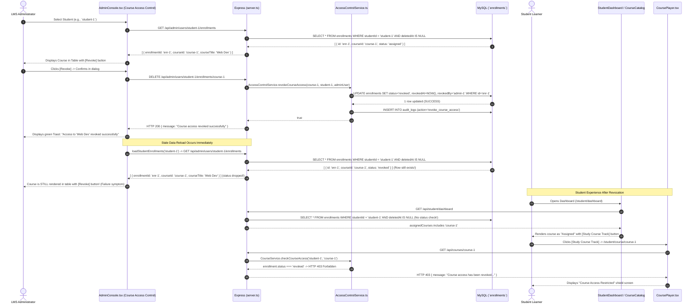

# MRTECHLMS — Course Access Revocation: Existing Implementation & Failure Analysis

**Project Path:** `D:\malla\office\MRTECHLMS`  
**Author:** AI Technical Audit Agent  
**Date:** October 7, 2026  
**Status:** In-Depth Diagnosis & Architectural Audit (Non-Destructive)

---

## 1. Executive Summary & Problem Statement

### 1.1 Observed Issue
In the **Admin Portal** under **Manage Users → Course Access Control** (`/admin/users`, subtab `access`), selecting a student displays their active course enrollments. Clicking the **Revoke** button triggers a confirmation dialog; upon confirmation, the application shows a success notification (`Access to "<Course Title>" revoked successfully.`), but **the course remains displayed in the student's assigned courses table with the Revoke button still active**.

Furthermore, on the student side:
1. The revoked course **continues to appear on the Student Dashboard** (`/student/dashboard`) as an enrolled course.
2. The course **continues to display an "Assigned" status pill and an active "Study Course Track" button in the Course Catalog** (`/student/courses`).
3. When the student clicks "Study Course Track" to open the Course Player (`/student/course/:courseId`), the player requests `/api/courses/:id`, which returns `403 Forbidden` (`Course access has been revoked: Access revoked by administrator`), presenting a confusing "Course Access Restricted" shield screen instead of locking the course properly in the catalog.

### 1.2 Core Architectural Cause
The bug is **not** a database write failure. The backend **successfully** sets the database column `enrollments.status = 'revoked'`, `revokedAt = NOW()`, `revokedBy = actor.id`, and `revocationReason = ...` on the `enrollments` table.

However, the application suffers from an **asymmetric status consumption bug**:
* **Backend Mutation:** `AccessControlService.revokeCourseAccess()` marks the enrollment as `status: 'revoked'`. It intentionally does **not** soft-delete the row (`deletedAt` remains `NULL`) so progress history and audit trails are preserved.
* **Admin Enrollment Listing Endpoint Failure:** `GET /api/admin/users/:studentId/enrollments` in `server.ts` executes `enrollmentsDb.find({ studentId })`. This query returns **all** non-soft-deleted enrollment rows without filtering `status != 'revoked'`. Crucially, it maps the returned records to `{ enrollmentId, courseId, enrolledAt, courseTitle, category, instructorName }`, **completely dropping the `status` field**.
* **Admin Access Modal Endpoint Failure:** `GET /api/admin/users/:studentId/access` in `server.ts` checks `isAssigned: !!enrollment`. Because the enrollment row exists, `isAssigned` evaluates to `true` even when `status === 'revoked'`.
* **Student Dashboard Endpoint Failure:** `StudentLearningService.getStudentHomeData()` queries `FROM enrollments e JOIN courses c ON e.courseId = c.id WHERE e.studentId = ? AND e.deletedAt IS NULL`. It fails to include `AND e.status != 'revoked'`.
* **Course Player Gatekeeper:** `CourseService.checkCourseAccess()` is the **only** consumer that correctly checks `if (enrollment.status === 'revoked') return { allowed: false, status: 403 }`.

Because the listing endpoints return revoked enrollments as active courses, the frontend re-renders the course immediately after revocation, creating the illusion that clicking "Revoke" had no effect.

---

## 2. Component-by-Component Trace



---

## 3. Frontend Implementation Analysis

### 3.1 Primary Interface: `src/components/AdminConsole.tsx`

The Course Access Control subtab is rendered inside `src/components/AdminConsole.tsx` under `activeSubTab === "access"`.

#### Enrollment Fetching Function (`loadStudentEnrollments`)
* **File:** `src/components/AdminConsole.tsx` (lines 134–151)
* **Code:**
  ```typescript
  const loadStudentEnrollments = async (studentId: string) => {
    if (!studentId) return;
    setEnrollmentsLoading(true);
    setAccessMessage(null);
    try {
      const res = await fetch(`/api/admin/users/${studentId}/enrollments`, {
        headers: { "Authorization": `Bearer ${authToken}` }
      });
      if (res.ok) {
        const data = await res.json();
        setStudentEnrollments(data);
      }
    } catch (err) {
      console.error("Error loading student enrollments", err);
    } finally {
      setEnrollmentsLoading(false);
    }
  };
  ```
* **Trigger:** Invoked whenever `selectedStudentId` changes and `activeSubTab === "access"`, as well as immediately after granting or revoking access.

#### Revocation Click Handler (`handleRevokeCourseAccess`)
* **File:** `src/components/AdminConsole.tsx` (lines 441–471)
* **Code:**
  ```typescript
  const handleRevokeCourseAccess = async (courseId: string, courseTitle: string) => {
    if (!selectedStudentId) return;
    const ok = await confirm({
      title: "Revoke Course Access?",
      message: `Are you sure you want to revoke access to "${courseTitle}" for this student?`,
      confirmText: "Revoke Access",
      variant: "danger"
    });
    if (!ok) return;
    setAccessMessage(null);
    try {
      const res = await fetch(`/api/admin/users/${selectedStudentId}/enrollments/${courseId}`, {
        method: "DELETE",
        headers: { "Authorization": `Bearer ${authToken}` }
      });

      if (res.ok) {
        setAccessMessage({ 
          type: "success", 
          text: `Access to "${courseTitle}" revoked successfully.` 
        });
        loadStudentEnrollments(selectedStudentId);
        loadAdminDashboard();
      } else {
        const err = await res.json();
        setAccessMessage({ type: "error", text: err.error || "Failed to revoke access." });
      }
    } catch (err) {
      setAccessMessage({ type: "error", text: "Network error revoking course access." });
    }
  };
  ```

#### Table Rendering & Action Button
* **File:** `src/components/AdminConsole.tsx` (lines 980–1005)
* **Code:**
  ```tsx
  {studentEnrollments.map((en) => (
    <tr key={en.courseId} className="hover:bg-slate-50/50 transition">
      <td className="py-3 font-semibold text-slate-800">{en.courseTitle}</td>
      <td className="py-3 text-slate-500">{en.category}</td>
      <td className="py-3 text-slate-500">{new Date(en.enrolledAt).toLocaleDateString()}</td>
      <td className="py-3 text-right">
        <button
          onClick={() => handleRevokeCourseAccess(en.courseId, en.courseTitle)}
          className="inline-flex items-center gap-1 px-3 py-1.5 bg-rose-50 hover:bg-rose-100 text-rose-600 font-bold rounded-lg transition border border-rose-200 cursor-pointer text-xs"
          title="Revoke student course access"
        >
          <Trash2 className="w-3.5 h-3.5" />
          <span>Revoke</span>
        </button>
      </td>
    </tr>
  ))}
  ```
* **Observation:** The table blindly maps over `studentEnrollments`. It contains no conditional check for `en.status` or `en.rawStatus`, because the API never provides it.

### 3.2 Secondary Interface: User Access Modal (`handleRevokeCourseInModal`)
* **File:** `src/components/AdminConsole.tsx` (lines 528–550, 1740–1760)
* **Invoked From:** Manage Users table → Student Action menu → "Manage Course & Exam Access".
* **Code:**
  ```typescript
  const handleRevokeCourseInModal = async (courseId: string, courseTitle: string) => {
    if (!accessModalStudent) return;
    setAccessModalMessage(null);
    try {
      const res = await fetch(`/api/admin/users/${accessModalStudent.id}/enrollments/${courseId}`, {
        method: "DELETE",
        headers: { "Authorization": `Bearer ${authToken}` }
      });
      if (res.ok) {
        setAccessModalMessage({
          type: "success",
          text: `Access to course "${courseTitle}" revoked successfully.`
        });
        await loadAccessModalData(accessModalStudent.id);
        loadAdminDashboard();
      } else { ... }
  ```
* **Observation:** Calls the same `DELETE` endpoint and re-fetches `/api/admin/users/:studentId/access`.

---

## 4. Backend Implementation Analysis

### 4.1 Route Registrations in `server.ts`

#### Endpoint 1: `DELETE /api/admin/users/:studentId/enrollments/:courseId`
* **File:** `server.ts` (lines 1781–1795)
* **Code:**
  ```typescript
  app.delete("/api/admin/users/:studentId/enrollments/:courseId", authenticateToken, async (req, res) => {
    if (req.user!.role !== UserRole.ADMIN) {
      return res.status(403).json({ error: "Admin role required" });
    }

    const { studentId, courseId } = req.params;
    const { reason } = req.body || {};

    try {
      await AccessControlService.revokeCourseAccess(courseId, studentId, req.user!, reason);
      res.json({ message: "Course access revoked successfully" });
    } catch (err: any) {
      res.status(400).json({ error: err.message });
    }
  });
  ```
* **Status:** Fully functional. Validates role, extracts URL parameters, and delegates to `AccessControlService.revokeCourseAccess`.

#### Endpoint 2: `POST /api/admin/enrollments/revoke`
* **File:** `server.ts` (lines 1838–1852)
* **Code:** Alternative body-based endpoint used by `CourseAuthoringStudio.tsx`. Operates identically by calling `AccessControlService.revokeCourseAccess(courseId, studentId, req.user!, reason)`.

#### Endpoint 3 (The Flawed Endpoint): `GET /api/admin/users/:studentId/enrollments`
* **File:** `server.ts` (lines 1722–1747)
* **Code:**
  ```typescript
  app.get("/api/admin/users/:studentId/enrollments", authenticateToken, async (req, res) => {
    if (req.user!.role !== UserRole.ADMIN) {
      return res.status(403).json({ error: "Admin role required" });
    }

    const { studentId } = req.params;
    const student = await usersDb.findOne({ id: studentId });
    if (!student) return res.status(404).json({ error: "Student not found" });

    const enrollments = await enrollmentsDb.find({ studentId });
    const allCourses = await coursesDb.find();

    const enrolledCourses = enrollments.map(e => {
      const course = allCourses.find(c => c.id === e.courseId);
      return {
        enrollmentId: e.id,
        courseId: e.courseId,
        enrolledAt: e.enrolledAt,
        courseTitle: course ? course.title : "Unknown Course",
        category: course ? course.category : "General",
        instructorName: course ? course.instructorName : "Instructor"
      };
    });

    res.json(enrolledCourses);
  });
  ```
* **Flaws Identified:**
  1. `enrollmentsDb.find({ studentId })` executes `SELECT * FROM enrollments WHERE studentId = ? AND deletedAt IS NULL`. Because revocation only sets `status = 'revoked'` and leaves `deletedAt = NULL`, the revoked record is returned.
  2. The endpoint does **not** filter out `e.status === 'revoked'`.
  3. The endpoint does **not** return the `status` column in the JSON response, preventing the frontend from distinguishing active from revoked enrollments.

#### Endpoint 4 (The Flawed Access Matrix Endpoint): `GET /api/admin/users/:studentId/access`
* **File:** `server.ts` (lines 2012–2040)
* **Code:**
  ```typescript
  const enrollments = await enrollmentsDb.find({ studentId });
  const enrolledCourseMap = new Map(enrollments.map(e => [e.courseId, e]));

  const coursesList = allCourses.map(course => {
    const enrollment = enrolledCourseMap.get(course.id);
    return {
      id: course.id,
      title: course.title,
      category: course.category,
      status: course.status,
      instructorName: course.instructorName,
      isAssigned: !!enrollment, // <--- FLAW: true even when status === 'revoked'
      assignedDate: enrollment ? enrollment.enrolledAt : null,
      enrollmentId: enrollment ? enrollment.id : null
    };
  });
  ```

---

## 5. Service & Business Logic Analysis

### 5.1 Service Implementation: `server/services/access-control.service.ts`

#### Revocation Method (`revokeCourseAccess`)
* **File:** `server/services/access-control.service.ts` (lines 311–350)
* **Code:**
  ```typescript
  static async revokeCourseAccess(
    courseId: string, 
    studentId: string, 
    actor: { id: string; email?: string; role?: string },
    reason?: string
  ): Promise<boolean> {
    const enrollment = await enrollmentsDb.findOne({ studentId, courseId });
    if (!enrollment) {
      throw new Error("Active enrollment not found for this student and course");
    }

    const now = new Date().toISOString();
    await enrollmentsDb.update(enrollment.id, {
      status: "revoked",
      revokedAt: now,
      revokedBy: actor.id,
      revocationReason: reason || "Access revoked by administrator"
    });

    await logAuditEvent({
      userId: actor.id,
      userEmail: actor.email,
      userRole: actor.role,
      action: "revoke_course_access",
      resourceType: "course_enrollment",
      resourceId: enrollment.id,
      details: {
        courseId,
        studentId,
        reason: reason || "Access revoked by administrator",
        previousProgress: enrollment.progressPercentage
      }
    });

    // In-app Notification Trigger
    try {
      const course = await coursesDb.findOne({ id: courseId });
      await NotificationService.createNotification({
        userId: studentId,
        organizationId: (enrollment as any).organizationId || "org-default",
        type: "system_announcement",
        title: "Course Enrollment Revoked",
        message: `Your access to the course "${course?.title || 'Unknown Course'}" has been revoked.`,
        data: { courseId, reason }
      });
    } catch (e) {
      console.error("[Notification] Failed to notify student about course revocation:", e);
    }

    return true;
  }
  ```

#### Architectural Intent: Non-Destructive Soft Revocation
Notice that `revokeCourseAccess()`:
1. Updates `status: "revoked"`.
2. Sets `revokedAt`, `revokedBy`, and `revocationReason`.
3. Records a structured audit event in `audit_logs`.
4. Sends a notification to the student.
5. **Preserves `progressPercentage`, `lastLessonId`, and `progress` table records.**
6. Leaves `deletedAt: null`.

When re-assigning the course later (`AccessControlService.assignCourse`, line 150):
```typescript
if (existing) {
  // Re-activate or update existing enrollment record
  enrollment = await enrollmentsDb.update(existing.id, {
    status: existing.completedAt ? "completed" : (existing.progressPercentage || 0) > 0 ? "in_progress" : "assigned",
    assignedBy,
    assignedAt: now,
    revokedAt: null,
    revokedBy: null,
    revocationReason: null,
    deletedAt: null
  });
}
```
The architecture was deliberately designed around state-machine transitions between `'assigned'`, `'in_progress'`, `'completed'`, and `'revoked'`.

---

## 6. Database Schema & Data Integrity Analysis

### 6.1 MySQL Schema: `enrollments` Table
Direct database inspection (`DESCRIBE enrollments`) yields:

| Column | Type | Nullable | Key | Default | Notes |
|---|---|:---:|:---:|---|---|
| `id` | `varchar(36)` | NO | PRI | NULL | UUID v4 |
| `organizationId` | `varchar(36)` | YES | MUL | NULL | Multi-tenant scoping |
| `studentId` | `varchar(36)` | NO | MUL | NULL | References `users(id)` |
| `courseId` | `varchar(36)` | NO | MUL | NULL | References `courses(id)` |
| `enrolledAt` | `varchar(50)` | NO | | NULL | ISO timestamp |
| `completedAt` | `varchar(50)` | YES | | NULL | ISO timestamp |
| `lastLessonId` | `varchar(36)` | YES | | NULL | Last accessed lesson |
| `lastAccessedAt` | `varchar(50)` | YES | | NULL | ISO timestamp |
| `progressPercentage` | `int` | NO | | 0 | 0–100 progress |
| `status` | `enum('assigned','not_started','in_progress','completed','expired','revoked')` | NO | MUL | 'assigned' | **Core lifecycle status** |
| `assignedBy` | `varchar(36)` | YES | | NULL | Admin/Trainer user ID |
| `assignedAt` | `varchar(50)` | YES | | NULL | ISO timestamp |
| `dueDate` | `varchar(50)` | YES | MUL | NULL | Optional assignment deadline |
| `isMandatory` | `tinyint(1)` | NO | | 0 | Boolean flag |
| `assignmentSource` | `enum('individual','bulk','group','learning_path','self')` | NO | | 'individual' | Origin of enrollment |
| `assignmentSourceId` | `varchar(36)` | YES | | NULL | Source group/path ID |
| `revokedAt` | `varchar(50)` | YES | | NULL | Timestamp of revocation |
| `revokedBy` | `varchar(36)` | YES | | NULL | Admin ID who revoked |
| `revocationReason` | `text` | YES | | NULL | Documented reason |
| `deletedAt` | `varchar(50)` | YES | | NULL | Soft-deletion timestamp |

### 6.2 Table Constraints & Indexes
* **Primary Key:** `PRIMARY KEY (id)`
* **Unique Key:** `UNIQUE KEY student_course_uniq (studentId, courseId)`
* **Indexes:** `idx_enrollments_org`, `idx_enrollments_student_course`, `idx_enrollments_status`, `idx_enrollments_due_date`, `idx_enr_org_status_comp`, `idx_enr_course_progress`

> [!IMPORTANT]
> Because of the unique constraint `student_course_uniq (studentId, courseId)`, soft revocation via `status = 'revoked'` is strictly superior to deleting or inserting new records, because it avoids unique key collisions while keeping student progress history intact.

---

## 7. Student-Side Authorization & Anti-Bypass Analysis

### 7.1 Course Player Gatekeeper: `CourseService.checkCourseAccess`
* **File:** `server/services/course.service.ts` (lines 688–758)
* **Enforced On:**
  * `GET /api/courses/:id` (Course Player boot)
  * `POST /api/courses/:id/enroll` (Self-enrollment)
  * `POST /api/lessons/:id/complete` (Lesson completion)
* **Code:**
  ```typescript
  // 3. Enrollment check
  const enrollment = await enrollmentsDb.findOne({ studentId: user.id, courseId: course.id });
  if (!enrollment) {
    return { 
      allowed: false, 
      status: 403, 
      message: "Access denied. You are not enrolled in this course. Please contact your LMS Administrator." 
    };
  }

  // 4. Revocation check
  if (enrollment.status === "revoked") {
    return { 
      allowed: false, 
      status: 403, 
      message: `Course access has been revoked: ${enrollment.revocationReason || "Contact your LMS administrator."}` 
    };
  }
  ```
* **Result:** Direct URL navigation to `/student/course/:courseId` **is successfully blocked** with HTTP 403. A revoked student cannot play video lectures, complete lessons, or download assets.

### 7.2 Assessment Anti-Bypass Gatekeeper: `AccessControlService.checkAssessmentAccess`
* **File:** `server/services/access-control.service.ts` (lines 987–1018)
* **Code:**
  ```typescript
  if (assessment.courseId) {
    const courseAccess = await this.checkCourseAccess(studentId, assessment.courseId, userOrgId);
    if (!courseAccess.allowed) {
      return {
        allowed: false,
        status: 403,
        error: `Assessment is part of course "${assessment.courseId}". ${courseAccess.error}`
      };
    }
  }
  ```
* **Result:** If an assessment is attached to a course whose enrollment has been revoked, direct access to `/student/assessment/:assessmentId` and `POST /api/assessments/:id/submit` **is also strictly denied**.

### 7.3 Student UI Discrepancy
While backend security prevents data access, the Student UI displays false information:
1. `StudentLearningService.getStudentHomeData` (`server/services/student-learning.service.ts`, line 28):
   ```sql
   SELECT ... FROM enrollments e JOIN courses c ON e.courseId = c.id
   WHERE e.studentId = ? AND e.deletedAt IS NULL
   ```
   **Missing:** `AND e.status != 'revoked'`
2. `CourseCatalogPage.tsx` checks `enrolledCourseIds` returned by `/api/student/dashboard`. Because the revoked course is returned, the catalog displays the green "Assigned" badge and "Study Course Track" button instead of the locked "Access Required" state.

---

## 8. Contrast: How CourseAuthoringStudio Handles Revocation

To prove that the application was intended to support `status: "revoked"`, inspect `src/components/admin/CourseAuthoringStudio.tsx`:

* **Access Filter Tab (lines 2329):**
  ```typescript
  { id: "revoked", label: "Revoked", count: revokedCount }
  ```
* **Status Badge (line 2431):**
  ```tsx
  {row.status === "revoked" && (
    <span className="inline-flex items-center gap-1.5 px-2.5 py-1 rounded-full text-xs font-semibold bg-rose-50 text-rose-700 border border-rose-200">
      <UserX className="w-3.5 h-3.5 text-rose-600" />
      <span>Revoked</span>
    </span>
  )}
  ```
* **Action Buttons (line 2497):**
  ```tsx
  {row.rawStatus !== "revoked" ? (
    <button onClick={() => setShowRevokeModal(true)}>Revoke</button>
  ) : (
    <button onClick={() => handleRestoreAccess(row)}>Re-Enroll</button>
  )}
  ```
* **Active Count Calculation (line 1063):**
  ```typescript
  const enrolledCount = accessMatrix.filter(r => r.rawStatus !== "revoked").length;
  ```

In `CourseAuthoringStudio.tsx`, the access matrix API (`/api/admin/courses/:id/access`) explicitly includes `rawStatus: enr.status`. The studio correctly displays revoked students with a "Revoked" badge and offers a "Re-Enroll" action.

In contrast, `AdminConsole.tsx` (under Manage Users) was written without this filtering, leading directly to the user-reported bug.

---

## 9. Failure Diagnosis Summary

| Dimension | Audit Finding |
|---|---|
| **Root Cause Category** | Stale/Unfiltered Query Endpoint (`GET /api/admin/users/:studentId/enrollments`) |
| **Database Execution** | **Succeeded.** `status` updated to `'revoked'`, audit log inserted. |
| **API Response Code** | **HTTP 200 OK.** `{ message: "Course access revoked successfully" }`. |
| **Admin UI State** | **Stale.** Reloaded data includes the revoked enrollment because `server.ts` line 1731 does not filter by status. |
| **Modal UI State** | **Stale.** `/api/admin/users/:studentId/access` sets `isAssigned: !!enrollment` without checking status. |
| **Student Dashboard** | **Stale.** `StudentLearningService` lines 28 & 441 do not filter out `e.status = 'revoked'`. |
| **Student Player Access** | **Blocked.** `CourseService.checkCourseAccess` correctly returns HTTP 403 Forbidden. |

---

## 10. Expected Behavior Specification

When the Revoke bug is fixed, the system will behave as follows:

1. **Admin Selection:** The Administrator navigates to `/admin/users` and selects the "Course Access Control" subtab.
2. **Active Enrollment Display:** The table displays **only actively enrolled courses** (`status IN ('assigned', 'not_started', 'in_progress', 'completed')`). Revoked courses are excluded from the active list (or displayed in a distinct "Revoked History" tab/badge).
3. **Revocation Action:** Clicking **Revoke** prompts for confirmation (and optional reason). Upon confirmation:
   * The client calls `DELETE /api/admin/users/:studentId/enrollments/:courseId`.
   * The backend sets `status = 'revoked'`, `revokedAt = NOW()`, `revokedBy = admin.id`, and logs the audit event.
4. **Immediate UI Refresh:**
   * `GET /api/admin/users/:studentId/enrollments` returns **only active enrollments** (where `status != 'revoked'`).
   * The revoked course **immediately disappears** from the active enrollments table.
   * If the student has no other active courses, the table displays "No active courses assigned."
5. **Modal Consistency:**
   * In the "Manage Course & Exam Access" modal, `GET /api/admin/users/:studentId/access` sets `isAssigned: false` (or `status: "revoked"`).
   * The modal switches the button from "Revoke Access" to "Grant Access" (or "Re-Enroll").
6. **Student Portal Consistency:**
   * On `/student/dashboard`, `getStudentHomeData` filters out revoked enrollments (`AND e.status != 'revoked'`). The course no longer appears in "My Enrolled Courses" or "Continue Learning".
   * On `/student/courses`, the Course Catalog displays the course as locked (`Access Required`), preventing the student from entering a broken state.
   * Direct URL access to `/student/course/:courseId` continues to return HTTP 403 with a user-friendly revocation explanation.
7. **History Preservation:**
   * The student's completed lessons in the `progress` table and quiz attempts in `submissions` remain intact.
   * If the Admin re-grants access later, previous progress is restored.

---

## 11. Proposed Fix Blueprint (Non-Destructive Reference)

> [!NOTE]
> Per task constraints, these changes are **documented for future implementation** and have **not** been applied during this audit.

### Change 1: `server.ts` — `GET /api/admin/users/:studentId/enrollments` (Line 1731)
```typescript
// Proposed fix: Filter out revoked enrollments and return status
const enrollments = await enrollmentsDb.find({ studentId });
const activeEnrollments = enrollments.filter(e => e.status !== "revoked");
const allCourses = await coursesDb.find();

const enrolledCourses = activeEnrollments.map(e => {
  const course = allCourses.find(c => c.id === e.courseId);
  return {
    enrollmentId: e.id,
    courseId: e.courseId,
    enrolledAt: e.enrolledAt,
    status: e.status,
    progressPercentage: e.progressPercentage || 0,
    courseTitle: course ? course.title : "Unknown Course",
    category: course ? course.category : "General",
    instructorName: course ? course.instructorName : "Instructor"
  };
});
```

### Change 2: `server.ts` — `GET /api/admin/users/:studentId/access` (Line 2035)
```typescript
// Proposed fix: Only treat active enrollments as assigned
const enrollment = enrolledCourseMap.get(course.id);
const isAssigned = !!enrollment && enrollment.status !== "revoked";
```

### Change 3: `server/services/student-learning.service.ts` — Lines 28, 441, 521
```sql
-- Proposed fix: Exclude revoked enrollments from student home data
WHERE e.studentId = ? AND e.status != 'revoked' AND e.deletedAt IS NULL
```
```sql
-- Proposed fix: Allow revoked courses to appear in recommended list if appropriate
AND c.id NOT IN (SELECT courseId FROM enrollments WHERE studentId = ? AND status != 'revoked' AND deletedAt IS NULL)
```
