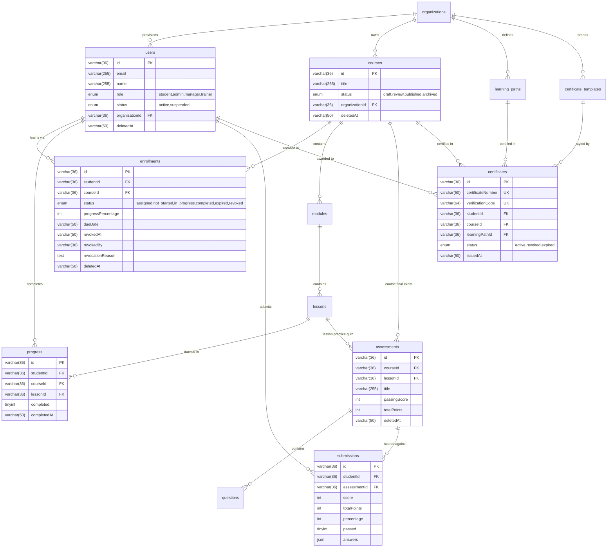
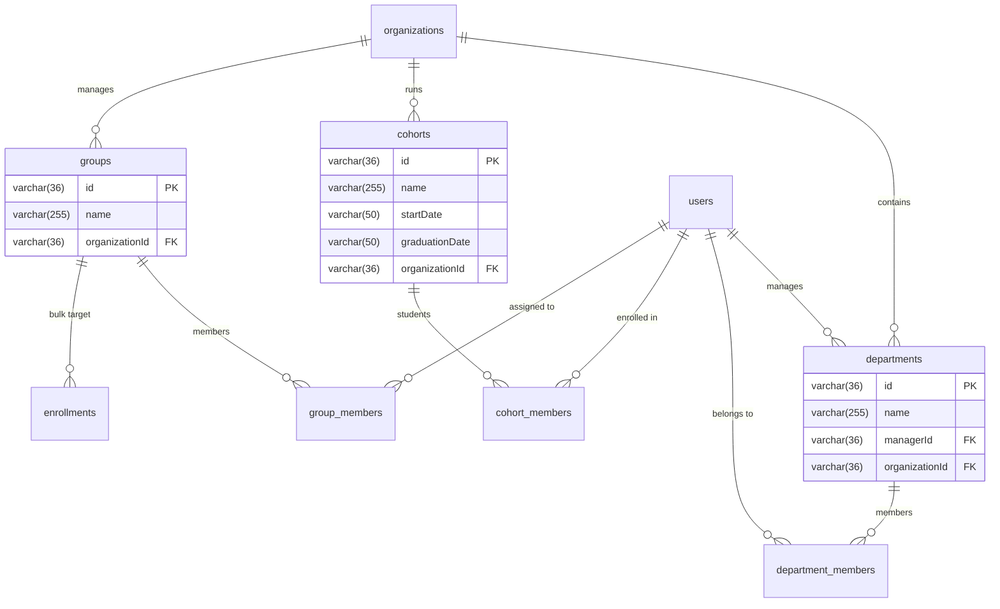
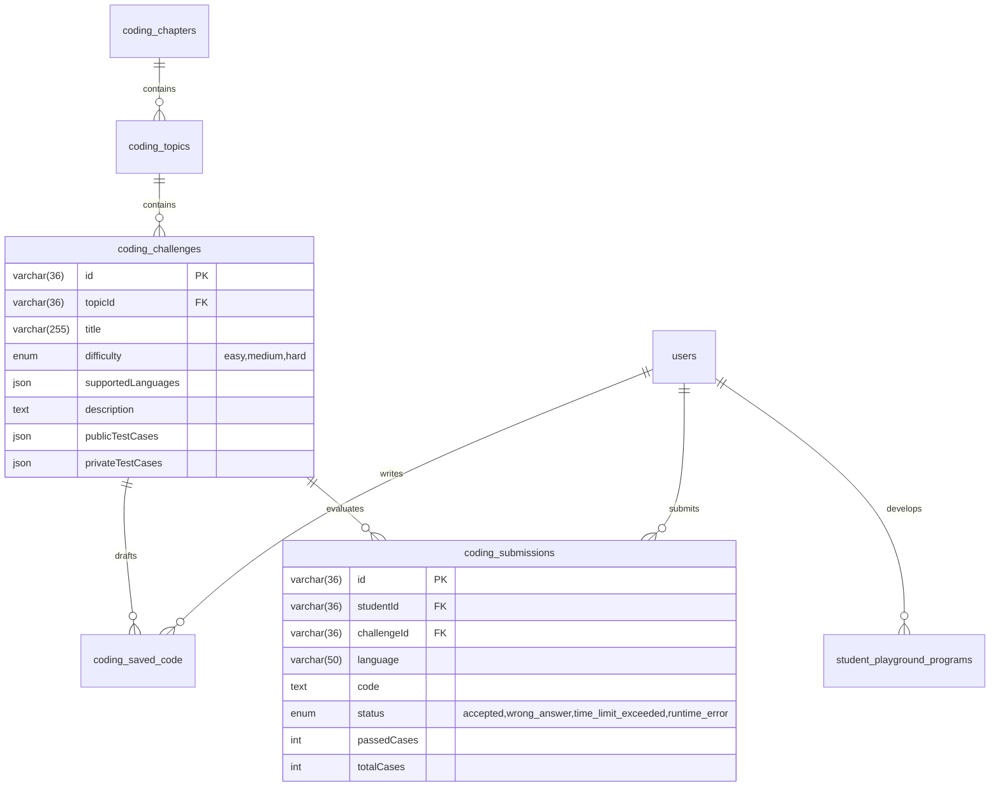

# MRTECHLMS — Complete Database Architecture & Schema Relationships

**Project Path:** `D:\malla\office\MRTECHLMS`  
**Database Server:** Local MySQL 8.0.43 on `127.0.0.1:3306`  
**Primary Database Schema:** `mrtechlms`  
**Connection Driver:** `mysql2/promise` with high-concurrency connection pooling (`server/mysql.ts`)  
**ORM / Abstraction Layer:** `MySQLCollection<T>` (`server/db.ts`)

---

## 1. Database Abstraction Layer Architecture

The database layer does not use a third-party ORM like Prisma or TypeORM. Instead, it utilizes an application-owned abstraction named `MySQLCollection<T>` (`server/db.ts`):

1. **Connection Pooling:** Initialized via `mysql2.createPool()` with `connectionLimit: 10`, `waitForConnections: true`, and `queueLimit: 0`.
2. **Transparent JSON Serialization:** Tables registered in `JSON_FIELDS` automatically stringify arrays/objects before SQL execution and `JSON.parse` them upon retrieval (e.g., `questions.options`, `submissions.answers`, `coding_challenges.publicTestCases`).
3. **Boolean Normalization:** Automatically converts integer `0/1` tinyint columns to JavaScript boolean `false/true` for keys prefixed with `is*` or named `completed`, `passed`, etc.
4. **Soft-Delete Filtering:** Tables in `SOFT_DELETABLE_TABLES` automatically append `` `deletedAt` IS NULL `` to `find()`, `findOne()`, and `count()` queries unless `{ includeDeleted: true }` is explicitly passed.
5. **Tenant Scoping:** Tables in `TENANT_SCOPED_TABLES` default `organizationId` to `"org-default"` if not provided during insertion.

---

## 2. Core Entity Relationship Diagrams

### 2.1 Core Learning, Enrollment, Assessment & Certification Flow

---

### 2.2 Organizational Hierarchy & Team Structure

---

### 2.3 Coding Practice & Execution Sandbox

---

## 3. Comprehensive Inventory of All 64 Tables

### Pillar 1: Identity, Security & Multi-Tenancy
1. **`users`** — Primary user accounts. Includes `id`, `name`, `email`, `role` (`student`, `admin`, `manager`, `trainer`), `status` (`active`, `suspended`), `passwordHash`, `organizationId`, `departmentId`, `managerId`, `deletedAt`.
2. **`organizations`** — Tenant entities. Stores tenant settings, subdomain, branding colors, custom domain, and quotas.
3. **`user_preferences`** — Learner preferences (dark mode, code editor keybindings, email alerts).
4. **`user_mfa_settings`** — Multi-factor authentication secrets, TOTP recovery codes, and MFA enabled status.
5. **`audit_logs`** — Immutable security compliance trail (`userId`, `action`, `resourceType`, `resourceId`, `ipAddress`, `status`, `details`).

### Pillar 2: Course Curriculum & Content Authoring
6. **`courses`** — Academy courses. Stores `title`, `description`, `shortDescription`, `category`, `difficulty`, `estimatedDuration`, `status` (`draft`, `review`, `published`, `archived`), `instructorName`, `thumbnail`, `banner`, `organizationId`, `deletedAt`.
7. **`modules`** — Structural course chapters. Stores `courseId`, `title`, `order`, `description`, `status`, `deletedAt`.
8. **`lessons`** — Individual learning assets. Stores `moduleId`, `courseId`, `title`, `type` (`video`, `text`, `pdf`, `quiz`, `code`), `durationMinutes`, `content`, `videoUrl`, `fileUrl`, `codingPrompt`, `order`, `assessmentId`, `deletedAt`.
9. **`learning_paths`** — Multi-course curated tracks (e.g. *Full Stack Web Architect*). Stores `title`, `category`, `difficulty`, `requirements`, `learningObjectives`, `organizationId`, `deletedAt`.
10. **`learning_path_sections`** — Stages/phases within a learning track.
11. **`learning_path_items`** — References courses or standalone assessments belonging to a track section.
12. **`blogs`** — Knowledge base and tech articles authored by instructors or students.
13. **`comments`** — Threaded discussions on blog posts.
14. **`reviews`** — Student ratings (1–5 stars) and testimonials on courses.

### Pillar 3: Enrollment, Access Control & Progress Tracking
15. **`enrollments`** — **Primary access control bridge between student and course.** Contains `id`, `organizationId`, `studentId`, `courseId`, `status` (`assigned`, `not_started`, `in_progress`, `completed`, `expired`, `revoked`), `progressPercentage`, `enrolledAt`, `completedAt`, `dueDate`, `isMandatory`, `assignmentSource`, `revokedAt`, `revokedBy`, `revocationReason`, `deletedAt`. Unique on `(studentId, courseId)`.
16. **`progress`** — Granular lesson completion tracking. Stores `studentId`, `courseId`, `lessonId`, `completed` (`0/1`), `completedAt`, `lastAccessedAt`.
17. **`learning_path_assignments`** — Tracks student enrollment into curated learning paths.
18. **`learning_path_progress`** — Milestone completion for learning paths.

### Pillar 4: Assessment Engine & Grading
19. **`assessments`** — Quizzes and examinations. Stores `title`, `description`, `courseId` (if course-final), `lessonId` (if lesson-quiz), `learningPathId`, `durationMinutes`, `passingScore`, `totalPoints`, `questionsCount`, `type` (`lesson_quiz`, `course_final`, `standalone`, `practice`), `deletedAt`.
20. **`questions`** — Questions bank. Stores `assessmentId`, `questionText`, `type` (`single_choice`, `multiple_choice`, `true_false`), `options` (JSON), `correctAnswers` (JSON), `points`, `negativePoints`, `explanation`, `order`.
21. **`submissions`** — Recorded student assessment attempts. Stores `studentId`, `assessmentId`, `studentName`, `score`, `totalPoints`, `percentage`, `passed` (`0/1`), `answers` (JSON), `createdAt`.
22. **`assessment_assignments`** — Standalone assessment access allocation for individual students.
23. **`assessment_attempts`** — Anti-cheat session state tracking attempt in progress, question display order, and elapsed time.

### Pillar 5: Coding Sandbox & Interactive Challenges
24. **`coding_chapters`** — High-level topic groupings (e.g. *Data Structures*, *Java Core*).
25. **`coding_topics`** — Sub-topics within chapters (e.g. *Binary Trees*, *Recursion*).
26. **`coding_challenges`** — 38 curriculum coding problems. Stores title, difficulty, descriptions, starter code, public and private test cases.
27. **`coding_saved_code`** — Persistent auto-saved draft code per student per problem.
28. **`coding_submissions`** — History of code runs and formal submissions evaluated against test cases.
29. **`coding_execution_jobs`** — Queue of asynchronous sandbox compilation jobs.
30. **`student_playground_programs`** — Free-form student coding projects outside structured curriculum.

### Pillar 6: Organizational Hierarchy
31. **`departments`** — Business units within a tenant organization.
32. **`department_members`** — Mapping between users and departments.
33. **`cohorts`** — Training batches with defined start and graduation dates.
34. **`cohort_members`** — Student membership in cohorts.
35. **`groups`** — Arbitrary assignment groups for bulk course access distribution.
36. **`group_members`** — User mapping in assignment groups.

### Pillar 7: Certification Engine
37. **`certificate_templates`** — Visual themes (`classic_gold`, `modern_emerald`, `executive_navy`, `tech_violet`), signatory details, and organizational crest assets.
38. **`certificates`** — Issued student credentials. Contains `certificateNumber` (e.g. `MR-CRS-2026-A8B9C2`), `verificationCode` (e.g. `v_9f2a7bc418e24c5b96d031aa`), `studentId`, `courseId`, `learningPathId`, `status` (`active`, `revoked`, `expired`), `issuedAt`, `expiresAt`, `signatoryName`, `signatoryTitle`.

### Pillar 8: Gamification & Engagement
39. **`gamification_profiles`** — Points tally, current level, current badge tier, and active streak.
40. **`gamification_badges`** — Badge definitions (e.g. *First Lesson Completed*, *Code Ninja*, *Perfectionist*).
41. **`gamification_student_badges`** — Badges unlocked by students.
42. **`gamification_points_ledger`** — Immutable credit ledger tracking why points were earned.
43. **`gamification_streak_logs`** — Daily learning activity tracking.
44. **`gamification_configs`** — Academy point reward tuning.

### Pillar 9: Communications, Alerts & Reminders
45. **`notifications`** — In-app alerts delivered to student or admin bell icon.
46. **`notification_preferences`** — User notification subscription toggles.
47. **`notification_templates`** — Reusable alert templates for due date reminders and course enrollment.
48. **`email_queue`** — Asynchronous outgoing email spool processed by background scheduler.
49. **`reminder_logs`** — Deduping log preventing duplicate overdue reminder emails.

### Pillar 10: Enterprise Integrations & Standards
50. **`api_keys`** — External integration tokens with scoped permissions (`courses:read`, `enrollments:write`).
51. **`webhook_subscriptions`** — Registered URLs receiving real-time event webhooks.
52. **`webhook_deliveries`** — Webhook delivery logs with status codes and retry counts.
53. **`sso_configs`** — SAML 2.0 / OAuth2 / OpenID Connect tenant identity provider settings.
54. **`lti_registrations`** — LTI 1.3 1EdTech institutional learning platform integration keys.
55. **`scorm_packages`** — Uploaded SCORM 1.2 / 2004 interactive zip modules.
56. **`scorm_registrations`** — SCORM runtime CMI tracking data.
57. **`xapi_lrs_destinations`** — Experience API (Tin Can) external Learning Record Store endpoints.
58. **`xapi_statements`** — Dispatched xAPI actor-verb-object learning statements.
59. **`integration_jobs`** — Asynchronous bulk data sync jobs.

### Pillar 11: AI Mentorship & Generative Layer
60. **`ai_organization_settings`** — Token quotas and enabled AI features per tenant.
61. **`ai_interaction_logs`** — Complete transcript logs of Gemini AI tutor sessions.
62. **`ai_generated_courses`** — Draft courses generated by AI syllabus builder.
63. **`ai_generated_quizzes`** — Draft question banks generated by AI quiz builder.

### Pillar 12: System Maintenance
64. **`schema_migrations`** — Migration version tracker managing the 15 schema migrations.

---

## 4. Foreign Key Constraints & Cascade Semantics

While the `MySQLCollection` abstraction enforces soft-deletes at the application level via `deletedAt IS NULL`, the underlying MySQL schema defines explicit foreign key relationships:

* **Curriculum Hierarchy:**
  * `modules.courseId` -> `courses.id` (`ON DELETE CASCADE`)
  * `lessons.moduleId` -> `modules.id` (`ON DELETE CASCADE`)
  * `lessons.courseId` -> `courses.id` (`ON DELETE CASCADE`)
  * `assessments.courseId` -> `courses.id` (`ON DELETE CASCADE`)
  * `questions.assessmentId` -> `assessments.id` (`ON DELETE CASCADE`)
* **Access Control & Submissions:**
  * `enrollments.studentId` -> `users.id`
  * `enrollments.courseId` -> `courses.id`
  * `progress.studentId` -> `users.id`
  * `progress.lessonId` -> `lessons.id`
  * `submissions.studentId` -> `users.id`
  * `submissions.assessmentId` -> `assessments.id`
* **Tenancy:**
  * `users.organizationId` -> `organizations.id`
  * `courses.organizationId` -> `organizations.id`
  * `departments.organizationId` -> `organizations.id`
