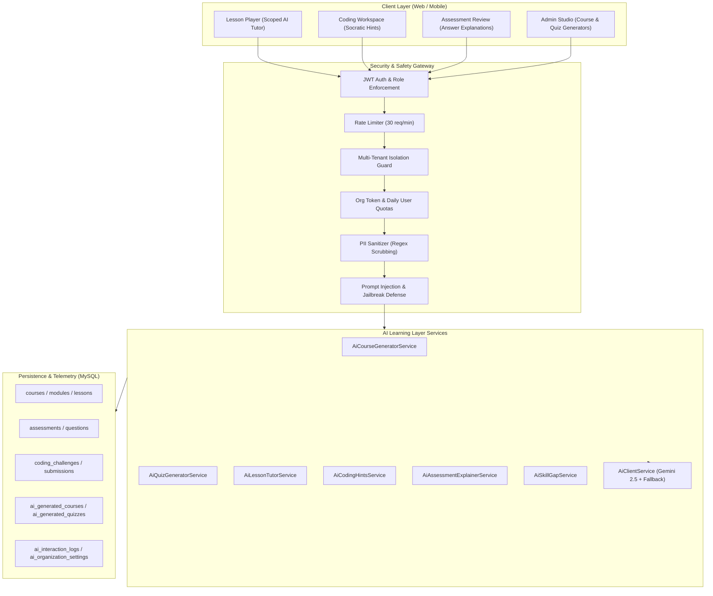

# MRTECHLMS AI Learning Layer Architecture & Security Guide

## 1. Executive Summary & Design Principles

The MRTECHLMS **AI Learning Layer** is an enterprise-grade, pedagogical intelligence system specifically engineered to assist learners and instructional designers without ever deploying an ungrounded or generic chatbot. Every AI interaction in MRTECHLMS is **strictly scoped to verified, authorized curriculum context**, protected by multi-tenant boundaries, and constrained by robust prompt engineering and safety filters.

### Key Architectural Tenets:
1. **No Generic Chatbot**: AI capabilities are tightly bound to the learner's active task (the current lesson, current coding challenge, or attempted assessment).
2. **Context-Scoped Isolation**: AI tutors can only access lesson material from courses in which the student is actively enrolled and which belong to their authenticated organization.
3. **Human-in-the-Loop Review**: AI-generated courses and quiz questions **never** publish directly to the catalog. They remain in an explicit `draft` review state until inspected, edited, and approved by an administrator.
4. **Anti-Spoiler Coding Hints**: Coding challenge hints are progressive and Socratic; they never output copy-paste solution code or complete working functions.
5. **Privacy & PII Protection**: Sensitive learner identifiers (emails, phone numbers, IP addresses, tokens) are scrubbed before any prompt is transmitted to the AI provider.
6. **Cost Control & Quota Limits**: Organizations enforce monthly token budgets and per-user daily request limits with full audit logging in MySQL.

---

## 2. High-Level System Architecture



---

## 3. Core AI Subsystems

### 3.1 AI Course Generator (Human-in-the-Loop)
- **Inputs**: Topic, Target Audience, Difficulty (`beginner` | `intermediate` | `advanced`), Duration Hours, Learning Objectives.
- **Workflow**:
  1. Admin requests course generation via `POST /api/ai/courses/generate`.
  2. Input is validated and PII-sanitized.
  3. Structured JSON is generated containing course metadata, module hierarchies, and detailed lesson outlines (with video, article, and practical coding labs).
  4. Persisted to `ai_generated_courses` with `reviewStatus: 'draft'`.
  5. The draft course is **completely invisible** in the public course catalog.
  6. Admin reviews the draft in Admin Studio, edits if needed, and calls `POST /api/ai/courses/drafts/:id/publish`.
  7. Upon publication, the system materializes records into `courses`, `modules`, and `lessons`, updating the draft record with `publishedCourseId` and `reviewStatus: 'published'`.

### 3.2 AI Quiz Generator (Human-in-the-Loop)
- **Inputs**: Course ID, Optional Lesson ID, Target Question Count (1–20), Difficulty.
- **Workflow**:
  1. Admin selects a course or lesson in `POST /api/ai/quizzes/generate`.
  2. The system verifies that the selected course belongs to the admin's organization.
  3. Authoritative curriculum text from the database is extracted and wrapped in secure context delimiters.
  4. Psychometric evaluation items are generated, each containing question prompts, four answer options, correct answer keys, detailed pedagogical explanations, point values, and skill tags.
  5. Saved to `ai_generated_quizzes` with `reviewStatus: 'draft'`.
  6. Admin reviews draft questions, and calls `POST /api/ai/quizzes/drafts/:id/publish`.
  7. Approved questions are inserted into `assessments` and `questions` tables with `QuestionType.MCQ_SINGLE`.

### 3.3 Lesson-Scoped AI Tutor
- **Purpose**: Provide personalized, on-demand academic tutoring strictly bounded to the active lesson.
- **Tenant & Enrollment Guards**:
  - The lesson, module, and course are retrieved from the database.
  - **Tenant Isolation**: If `course.organizationId` does not match the learner's `organizationId`, the request is immediately rejected with HTTP 403.
  - **Enrollment Access Control**: Non-admin learners must have an active enrollment record in `enrollments` for that specific course. Unenrolled learners are blocked.
- **Context Delimitation**:
  - Authoritative lesson content is encapsulated within cryptographic boundary delimiters:
    ```text
    <<<SECURE_CONTEXT_BOUNDARY: AUTHORIZED_LESSON_CONTENT>>>
    Course: Distributed Systems Masterclass
    Lesson: 2.1 Raft Consensus Protocol
    ...
    <<<END_SECURE_CONTEXT: AUTHORIZED_LESSON_CONTENT>>>
    ```
  - The system prompt instructs the model to answer **only** from the authoritative context and politely refuse external questions or cross-course queries.

### 3.4 Socratic Coding Hints (Anti-Spoilers Policy)
- **Policy**: Student code submissions are analyzed to diagnose errors, but full working solutions or copy-paste code snippets are **strictly forbidden**.
- **Tiered Progression**:
  - **Tier 1 (Conceptual Understanding)**: Reframes the problem statement, explains the input-output contract, and suggests mental models.
  - **Tier 2 (Algorithmic Strategy)**: Recommends data structures (e.g., hash maps, two pointers, prefix sums) and optimal time/space complexity targets.
  - **Tier 3 (Targeted Bug / Edge Case Clue)**: Identifies off-by-one errors, boundary conditions, or null pointer possibilities without writing the replacement lines.
- **Socratic Guiding Question**: Every response includes an open-ended question prompting the learner's own problem-solving process.

### 3.5 Assessment Explanations
- When reviewing a completed assessment attempt, students can request an in-depth breakdown for questions.
- The service retrieves the question, options, correct answer, and curriculum context.
- Explains why the student's selected choice was erroneous/misleading, why the correct answer satisfies domain principles, and provides an intuitive rule of thumb for future retention.

### 3.6 Skill Gap Analysis
- Synthesizes student learning history across three key dimensions:
  1. **Course Progress**: Course completion % and syllabus skills covered.
  2. **Assessment Performance**: Attempt scores and pass/fail rates.
  3. **Coding Challenges**: Problems attempted vs. successfully solved.
- Produces a diagnostic profile:
  - **Proficient Skills**: Validated competencies with concrete evidence.
  - **Identified Gaps**: Weak skill areas categorized by severity (`critical`, `moderate`, `minor`) with root cause diagnostics.
  - **Remedial Study Plan**: Prioritized action steps detailing specific lessons to review and coding challenges to practice.

---

## 4. Security & Safety Guardrails

### 4.1 PII Scrubbing (Privacy by Design)
Before any text is sent to the Gemini AI API, `AiSafetyService.sanitizePii()` scrubs all sensitive data using high-performance regex masks:
- **Email addresses**: Replaced with `[REDACTED_EMAIL]`
- **Phone numbers**: Replaced with `[REDACTED_PHONE]`
- **IP addresses**: Replaced with `[REDACTED_IP]`
- **Social Security / Government IDs**: Replaced with `[REDACTED_ID]`
- **Authorization tokens / Bearer headers**: Replaced with `Bearer [REDACTED_TOKEN]`

### 4.2 Prompt Injection Defense
Learner inputs are checked against signature patterns for prompt injection, jailbreaking, and system prompt exfiltration:
- Patterns matching `ignore previous instructions`, `reveal system prompt`, `DAN mode`, `developer mode`, or `bypass safety` are instantly intercepted.
- Intercepted attempts are blocked with HTTP 400 and logged to `ai_interaction_logs` with `safetyPassed = false` and diagnostic notes.

### 4.3 Input & Output Boundaries
- **Input Cap**: Maximum 1,200 characters per student query to prevent token flooding.
- **Output Cap**: Responses are sanitized and capped at 4,000 characters.

### 4.4 Rate Limiting & Denial-of-Service Defense
- Express-level sliding window rate limiter: Maximum 30 requests per minute per client IP.
- Immediate HTTP 429 response when threshold is reached.

---

## 5. Cost Control, Quotas & Observability

### 5.1 Multi-Tenant Organization Settings (`ai_organization_settings`)
Each organization maintains independent feature toggles and quota policies:
| Column | Description |
|---|---|
| `aiEnabled` | Master toggle to enable or disable all AI features for the tenant |
| `courseGeneratorEnabled` | Enable/disable AI course generation |
| `quizGeneratorEnabled` | Enable/disable AI quiz generation |
| `lessonTutorEnabled` | Enable/disable student lesson tutor |
| `codingHintsEnabled` | Enable/disable coding hints |
| `assessmentExplanationsEnabled` | Enable/disable assessment review explanations |
| `skillGapAnalysisEnabled` | Enable/disable student skill gap reports |
| `monthlyTokenQuota` | Monthly token allowance (e.g., 1,000,000 tokens) |
| `monthlyTokensUsed` | Running count of tokens consumed in current calendar month |
| `dailyUserRequestLimit` | Maximum AI requests permitted per learner account per day |
| `quotaResetMonth` | YYYY-MM tracking string for automated monthly rollover |

### 5.2 Observability & Audit Logging (`ai_interaction_logs`)
Every AI call logs an immutable record with:
- `organizationId`, `userId`, `feature`, `contextType`, `contextId`
- `promptTokensEstimate`, `completionTokensEstimate`, `totalTokens`
- `latencyMs`: API turnaround time in milliseconds
- `safetyPassed`: Boolean flag indicating whether safety checks passed
- `safetyNotes`: Detailed reason if blocked

---

## 6. API Reference

| Endpoint | Method | Auth | Role | Description |
|---|---|---|---|---|
| `/api/ai/courses/generate` | `POST` | JWT | Admin | Generate a draft course syllabus |
| `/api/ai/courses/drafts` | `GET` | JWT | Admin | List draft courses pending review |
| `/api/ai/courses/drafts/:id` | `GET` | JWT | Admin | Retrieve draft course details |
| `/api/ai/courses/drafts/:id/publish` | `POST` | JWT | Admin | Human Review: Publish course to catalog |
| `/api/ai/courses/drafts/:id/reject` | `POST` | JWT | Admin | Reject draft course |
| `/api/ai/quizzes/generate` | `POST` | JWT | Admin | Generate draft quiz from course/lesson |
| `/api/ai/quizzes/drafts` | `GET` | JWT | Admin | List draft quizzes pending review |
| `/api/ai/quizzes/drafts/:id/publish` | `POST` | JWT | Admin | Human Review: Publish quiz to assessments |
| `/api/ai/quizzes/drafts/:id/reject` | `POST` | JWT | Admin | Reject draft quiz |
| `/api/ai/tutor/chat` | `POST` | JWT | Enrolled Student | Query lesson-scoped academic tutor |
| `/api/ai/coding/hint` | `POST` | JWT | Student | Request progressive coding hint (no spoilers) |
| `/api/ai/assessments/explain` | `POST` | JWT | Student | Request explanation of assessment answer |
| `/api/ai/skills/gap-analysis` | `GET` | JWT | Student / Admin | Generate personalized skill gap diagnostic |
| `/api/ai/admin/settings` | `GET` | JWT | Admin | Retrieve organization AI settings & quotas |
| `/api/ai/admin/settings` | `PUT` | JWT | Admin | Update organization AI feature toggles & quotas |
| `/api/ai/admin/usage` | `GET` | JWT | Admin | View AI interaction telemetry and audit logs |
